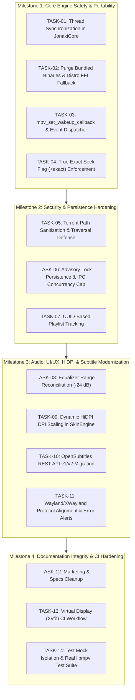

# JONAKI PLAYER — AUDIT REMEDIATION PLAN
**Target:** v0.9.0-rc1 → v1.0.0-GA  
**Role:** Senior Linux Desktop Application Engineer  
**Date:** October 2026  
**Document Reference:** `AUDIT_REMEDIATION_PLAN.md`

---

## 1. Remediation Philosophy & Architecture Principles

To achieve production certification (`v1.0.0-GA`) without breaking working features:
1. **Preserve Established Working Architecture:** Protect existing audio DSP pipelines, GTK layouts, Cairo OSD, and MPRIS2 integration.
2. **Safe Lock Boundaries:** In `JonakiCore`, use `threading.RLock()` to guard the C-FFI `mpv_handle` lifecycle. C callback functions must never acquire application locks, preventing lock inversion and deadlocks.
3. **Event-Driven Libmpv Integration:** Replace busy-polling with `mpv_set_wakeup_callback()`. Wakeup triggers drain libmpv's event queue via `mpv_wait_event(h, 0)` and dispatch UI updates to the GTK main thread using `GLib.idle_add()`.
4. **Clean Packaging & Portability:** Purge all bundled precompiled `.so` binaries. Implement standard `ctypes.util.find_library` dynamic discovery with graceful fallback and clear diagnostics.
5. **Defense-in-Depth Security:** Validate untrusted BitTorrent metadata paths using strict `os.path.commonpath` checks; preserve advisory flock files on disk; bound IPC server concurrency.

---

## 2. Milestone Execution Roadmap

---

## 3. Milestone Technical Specifications

### Milestone 1 — Core Engine Safety & Portability
- **TASK-01 (Thread Safety):**
  - Add `self._lock = threading.RLock()` in `JonakiCore`.
  - Add safe invocation helper `_call_mpv()` ensuring `self.handle` is valid before invoking C-FFI methods.
  - In `stop_engine()`, acquire lock, set `self._is_running = False`, capture handle pointer `h = self.handle`, set `self.handle = None`, and release lock before invoking `mpv_terminate_destroy(h)`. This guarantees no thread can begin a call on `h` after teardown starts, and teardown cannot deadlock with an in-flight call.
- **TASK-02 (System libmpv Discovery):**
  - Delete `lib/libmpv.so.2.5.0` and `src/gi/_gi_cairo.cpython-313-x86_64-linux-gnu.so`.
  - Update `_load_bundled_libmpv()` to discover system libraries via `ctypes.util.find_library('mpv')`, searching standard sonames (`libmpv.so.2`, `libmpv.so.1`, `libmpv.so`).
  - Update `install.sh` to install native dependencies (`libmpv-dev`, `python3-gi-cairo`) on Debian/Ubuntu, Fedora, and Arch.
- **TASK-03 (Wakeup Callback & Event Loop):**
  - Declare `mpv_set_wakeup_callback` with `ctypes.CFUNCTYPE(None, ctypes.c_void_p)`.
  - Maintain a persistent Python callback reference to prevent GC collection.
  - Callback schedules `GLib.idle_add(self._drain_mpv_events)` on the GTK main loop.
  - `_drain_mpv_events()` drains events non-blockingly using `mpv_wait_event(handle, 0)` until `MPV_EVENT_NONE`.
  - Decommission the 100ms polling timer for state events; maintain a 250ms timer only during active playback for smooth scrubber updates if needed.
- **TASK-04 (Exact Seeking):**
  - Update `seek_relative(delta, exact=True)` and `seek_absolute(target, exact=True)`.
  - Format commands as `seek <val> relative+exact` or `relative+keyframes` (for scrub drag).

---

### Milestone 2 — Security & Persistence
- **TASK-05 (BitTorrent Path Traversal):**
  - Add `_sanitize_torrent_path(base_dir, untrusted_rel_path)` in `src/torrent/engine.py`.
  - Use `os.path.abspath` and `os.path.commonpath([base_dir, target_dir]) == base_dir` to block traversal attacks.
- **TASK-06 (Advisory Lock & IPC Concurrency):**
  - Stop unlinking the lock file in `IPCServer._release_lock()`. Unlock via `fcntl.flock(fd, fcntl.LOCK_UN)` and close the descriptor.
  - Add connection concurrency cap using a `threading.BoundedSemaphore(10)`.
- **TASK-07 (Playlist UUID Tracking):**
  - Assign each playlist item a `uuid.uuid4().hex` identifier.
  - Update `PlaylistView` to store the UUID in an internal column, preserving duplicate entries during drag-and-drop reordering.

---

### Milestone 3 — Audio, UI/UX, HiDPI & Subtitles
- **TASK-08 (Equalizer Range):**
  - Update `JonakiCore.set_equalizer_band()` to clamp `[-24.0, +12.0]` dB.
- **TASK-09 (HiDPI Scaling):**
  - Query `window.get_scale_factor()` in `SkinEngine`.
  - Apply `cr.scale(scale, scale)` for crisp vector rendering and scale input event hitboxes.
- **TASK-10 (OpenSubtitles REST API v1/v2):**
  - Update `SubtitleSearchClient` to use modern `https://api.opensubtitles.com/api/v1/subtitles`.
  - Add API key header support and safe file downloading.
- **TASK-11 (Wayland & Desktop Integration):**
  - Detect XWayland when running under Wayland.
  - Provide a clean GUI alert if neither X11 nor XWayland is available.
  - Update documentation to accurately describe XWayland architecture.

---

### Milestone 4 — Documentation & CI Hardening
- **TASK-12 (Claims Cleanup):**
  - Clean up `README.md`, `MEMORY.md`, and specifications.
  - Remove unsupported "zero-copy" and Windows VapourSynth script claims.
- **TASK-13 (CI Workflow):**
  - Create `.github/workflows/ci.yml` running unit tests and integration tests with `xvfb-run`.
- **TASK-14 (Real libmpv Integration Tests):**
  - Add tests in `tests/test_libmpv_integration.py` exercising live libmpv handle operations without mocks.
