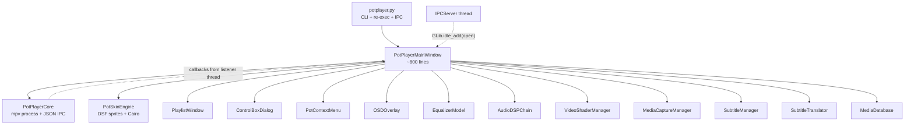

# PotPlayer for Linux — Project Audit

**Audit date:** 2026-10-25  
**Repository:** `/home/ashik/Data/Projects/PotPlayer`  
**Snapshot:** 19 Python modules under `src/`, 5 test modules under `tests/`, 9 documents under `docs/`  
**Scope:** source, tests, documentation, assets, packaging, legal/compliance, runtime behavior  
**Constraint:** this audit changes no source code; it is a review document only.

---

## Contents

1. [Executive summary](#1-executive-summary)
2. [Scorecard](#2-scorecard)
3. [What already works](#3-what-already-works)
4. [P0 — release-blocking defects](#4-p0--release-blocking-defects)
5. [P1 — major functional defects](#5-p1--major-functional-defects)
6. [P2 — incomplete features and design problems](#6-p2--incomplete-features-and-design-problems)
7. [P3 — polish and maintainability](#7-p3--polish-and-maintainability)
8. [Feature reality matrix](#8-feature-reality-matrix)
9. [Architecture review](#9-architecture-review)
10. [Documentation audit](#10-documentation-audit)
11. [Test and CI audit](#11-test-and-ci-audit)
12. [Performance review](#12-performance-review)
13. [Security and privacy review](#13-security-and-privacy-review)
14. [Legal and licensing review](#14-legal-and-licensing-review)
15. [Packaging and developer experience](#15-packaging-and-developer-experience)
16. [Accessibility, UX, and internationalization](#16-accessibility-ux-and-internationalization)
17. [Repository hygiene](#17-repository-hygiene)
18. [Recommended roadmap](#18-recommended-roadmap)
19. [Verification appendix](#19-verification-appendix)

---

## 1. Executive summary

This repository is a **working X11 prototype of an mpv front-end with a PotPlayer-inspired skin**, not the “open-source, pixel-accurate, feature-complete clone” that `docs/README.md` describes. The basic path works: GTK 3 creates a window, mpv is embedded through `--wid` on X11, files can be queued, and a Cairo-drawn control bar provides playback and volume controls. The module layout is understandable, and several isolated components (equalizer, bookmark storage, capture helpers, IPC round-trip) are real implementations rather than mock-ups.

The project is **not ready for users, distribution, or a public “release” description** in its current state:

- **Absolute Linux file paths are silently discarded.** `potplayer /home/user/movie.mkv` is parsed as an unknown `/` switch and produces an empty playlist. This breaks the most common invocation and the example in the development guide.
- **`/volume`, `/seek`, `/sub`, and `/aud` are applied before mpv exists.** The commands are sent to an unstarted engine and silently dropped. The same ordering problem affects every launch, not only delegated instances.
- **Playlist advancement reacts to every `end-file` event**, including `stop`, `error`, and file replacement. Pressing F4 can advance to the next track; loading a replacement can skip items.
- **Pure Wayland is not supported despite the documentation.** The code requires an X11 window ID and forces `GDK_BACKEND=x11` when `$DISPLAY` exists. On a Wayland-only session, mpv is launched without `--wid` and opens a separate window.
- **Several visible controls call methods that do not exist.** The Control Box subtitle slider/checkbox and the playlist Remove/Sort/Shuffle buttons raise `AttributeError`. Most context-menu actions are no-ops.
- **The documentation describes a different, much larger product.** GTK 4, Wayland/EGL, MPRIS2, Whisper, VapourSynth, AngelScript, multi-subtitle tracks, 34 shaders, AppImage/Flatpak/deb packaging, and many files do not exist in the repository.
- **There is a serious legal mismatch.** The bundled PotPlayer EULA prohibits reverse engineering, decompilation, and modification; the repository redistributes proprietary Windows binaries, skins, and branding; it has no project license; and its About dialog attributes copyright to Kakao.

**Bottom line:** treat this as a **pre-alpha prototype and a reverse-engineering notebook**, not a shippable player. Fix the P0 items first, then make the documentation match the code before adding features.

### Severity model used in this report

| Level | Meaning |
| :--- | :--- |
| **P0** | Breaks a primary user path, causes data loss, or blocks any credible release. |
| **P1** | A major advertised feature is broken, crashes, or behaves dangerously. |
| **P2** | Feature is incomplete, unreliable, or architecturally fragile but has a workaround. |
| **P3** | Polish, maintainability, accessibility, or hygiene issue. |
| **Legal** | Release blocker independent of code quality; requires a product/legal decision. |

---

## 2. Scorecard

| Area | Rating | Assessment |
| :--- | :---: | :--- |
| Build and first launch | 2/5 | Runs on X11 with system GTK 3/PyGObject/mpv; no dependency manifest; absolute-path launch is broken. |
| Core playback (X11) | 3/5 | mpv embedding and basic transport work; end-of-file, startup order, and error handling are unsafe. |
| CLI compatibility | 1/5 | Many switches are tokenized but ignored; absolute paths fail; documented POSIX aliases mostly do not parse. |
| Playlist and main UI | 2/5 | Basic list and skin bar exist; search/sort/shuffle/remove are broken; index tracking is inconsistent. |
| Audio | 2/5 | Equalizer model is real; default DSP chain alters all audio, mono downmix is defective, and one filter parameter is invalid. |
| Subtitles | 1/5 | mpv/libass handles basic subtitle display; the advertised translation, search, multi-track, and STT features are not integrated. |
| Desktop integration | 1/5 | IPC exists but is limited and has an ownership bug; MPRIS is an unused stub; desktop file is not installable. |
| Documentation | 1/5 | Extensive and well-written, but describes mostly unimplemented behavior and references missing files. |
| Tests and CI | 2/5 | 15 fast tests pass with an environment workaround; almost all runtime behavior is untested; no CI. |
| Packaging | 1/5 | No pyproject, requirements, AppImage, Flatpak, deb, install target, or reproducible build. |
| Legal and licensing | 0/5 | No project license, proprietary artifacts redistributed, EULA conflict, trademark and attribution issues. |
| **Overall** | **~1.5/5** | **Pre-alpha prototype; not production-ready and not legally distributable as-is.** |

---

## 3. What already works

These are genuine strengths worth preserving:

1. **Clear top-level module split.** `core/`, `ui/`, `audio/`, `video/`, `subtitle/`, and `extensions/` communicate intent and make the code easy to navigate.
2. **mpv is a sensible engine choice.** JSON IPC over a Unix socket, `--idle=yes`, property observers, and `--wid` embedding are a pragmatic Linux equivalent to a DirectShow graph.
3. **X11 embedding works.** When a real X11 `GdkWindow` exists, `get_xid()` supplies a window ID to mpv, and the video is embedded in the player window.
4. **The Cairo skin bar is a real renderer.** Five sprite sheets are read from the DSF ZIP, controls are laid out, hover/pressed states are tracked, and the timebar/bookmarks/A-B range are drawn.
5. **The equalizer model is coherent.** Ten octave bands, clipping to ±12 dB, presets, and FFmpeg filter-string generation are implemented and tested.
6. **Capture helpers are functional.** Frame screenshot delegation, GIF palette generation, storyboard tiling, and clipboard fallback are plausible FFmpeg/utility integrations.
7. **Persistence schema is thoughtfully designed.** History, bookmarks, albums, playlist items, and settings tables exist; bookmarks are actually added and drawn.
8. **IPC has a working round-trip and tests.** The client/server JSON-over-Unix-socket path is small and testable.
9. **The test suite is fast.** Fifteen tests complete in roughly 0.1 seconds when the environment workaround is used, which is a good base for a real suite.
10. **The documentation is a useful reverse-engineering inventory**, even where it overstates implementation. It records artifact names, class names, and intended behavior that can guide prioritization.

The problem is not a lack of ambition or structure. It is the gap between the documented target and the implemented subset, plus a handful of defects in the few paths that do exist.

---

## 4. P0 — release-blocking defects

### P0-1. Absolute Linux paths are parsed as switches and silently discarded

**Where:** `src/potplayer.py:84-161`, especially the switch test at line 89 and the content fallback at lines 150-161.  
**Evidence:** a probe of `parse_arguments(["potplayer", "/tmp/movie.mkv"])` returns `contents == []`. A relative path such as `movie.mkv` is accepted because it does not begin with `/`.  
**Why it happens:** every argument beginning with `/` is treated as a PotPlayer Windows switch:

```python
if lower.startswith("/") or lower.startswith("--") or (...):
    sw = lower.lstrip("/").lstrip("-")
    ...
```

`/tmp/movie.mkv` becomes the unknown switch `tmp/movie.mkv`; no branch matches it, and there is no final “otherwise treat as content” fallback. The same applies to `/home/...`, `/media/...`, `/mnt/...`, and every other absolute POSIX path.

**Impact:** the normal Linux invocation is broken, including the example in `docs/LINUX_DEVELOPMENT_GUIDE.md:132` (`python3 src/potplayer.py /path/to/video.mkv`). Desktop launchers and file managers generally pass absolute paths, so double-clicking a video can open an empty player.

**Recommendation:** classify content before switches. A safe order is:

1. If the token is exactly `-`, treat it as stdin.
2. If it is a recognized URL scheme, treat it as content.
3. If `os.path.exists(token)` or `glob.has_magic(token)` matches, treat it as content.
4. Only then interpret a leading `/` or `-` as a switch, and reject unknown switches explicitly instead of dropping them.

Add a regression test for absolute paths, paths containing spaces, `file://` URIs, and unknown switches.

### P0-2. Initial `/volume`, `/seek`, `/sub`, and `/aud` are applied before mpv starts and are dropped

**Where:** `src/potplayer.py:188-200`; engine startup happens later in `src/ui/main_window.py:114-128`; `_send_command` returns immediately when the engine is not running (`src/core/engine.py:132-145`).  
**Evidence:** the sequence in `main()` is:

1. construct `PotPlayerMainWindow` (does not start mpv),
2. call `win.core.set_volume(...)`, `seek_absolute(...)`, `load_subtitle(...)`, `load_audio_track(...)`,
3. start the IPC server,
4. call `win.show_all()`, which triggers `_on_video_realize` and only then `start_engine()`.

Because `_is_running` is still false, every one of those commands is a no-op. The initial media file survives only because `_on_video_realize` explicitly reloads `self.playlist[self.current_index]`.

**Impact:** four documented startup switches do nothing. A user who launches with `/seek=00:05:00` starts at zero; `/sub=...` and `/aud=...` are lost; `/volume=...` leaves mpv at its default. This affects direct launches, not just delegated ones.

**Recommendation:** introduce an explicit engine-ready barrier. Either start the engine before constructing/applying launch options, or queue startup options and flush them from a `core_ready` callback after `start_engine()` succeeds. Test this with a fake core that records command order, and add one end-to-end test with a real short media file.

### P0-3. Playlist advances on every `end-file` event, including Stop and file replacement

**Where:** `src/core/engine.py:209-211`; `src/ui/main_window.py:666-669`; `src/core/engine.py:252-257`.  
**Evidence:** mpv emits `end-file` with a `reason` field (`eof`, `stop`, `error`, `quit`, etc.). The handler ignores the reason and calls `on_file_end()` unconditionally. `_on_core_file_end` then calls `play_index(current_index + 1)`. A probe confirmed that a stop event triggers advancement. Loading a new file with `loadfile ... replace` can also produce an `end-file` for the outgoing file, which can cascade into an unintended skip.

**Impact:** pressing F4 (Stop) can start the next track. A failed file can skip forward. Replacing the current file may advance two items. On a playlist, this looks like random track skipping and is a data/experience loss.

**Recommendation:** pass the event payload or reason to the callback and advance only when `reason == "eof"`. Guard against re-entrancy while a new file is loading, and disable auto-advance when the user explicitly stops or closes. Add tests for `eof`, `stop`, `error`, and replacement events.

### P0-4. Pure Wayland launches an external mpv window or fails; Wayland support is only claimed in docs

**Where:** `src/ui/main_window.py:114-124` (`get_xid()`), `src/potplayer.py:11-17` (forced `GDK_BACKEND=x11`), `src/core/engine.py:69-96` (`--vo=gpu,x11`, `--force-window=yes`, `--wid` only when available).  
**Evidence:** `Gdk.Window.get_xid()` exists only for the X11 backend. On a Wayland-only session there is no `$DISPLAY`, so the re-exec does not run, `get_xid()` raises, `wid` remains `None`, and `start_engine()` launches mpv without `--wid`. Because `--force-window=yes` is set, mpv creates its own window; the GTK window remains a logo/control shell. With `--vo=gpu,x11` and no X server, mpv may fail to initialize at all.

**Impact:** the application is not a Wayland player. On modern Fedora/Ubuntu Wayland sessions, users see either a detached video window or a blank player. The documentation repeatedly claims native Wayland/EGL support.

**Recommendation:** choose and document one of two honest paths:

- **Short term:** require X11/XWayland, detect the absence of `$DISPLAY` and show a clear error or force XWayland explicitly; remove Wayland claims from the docs.
- **Long term:** use libmpv’s render API with `GtkGLArea`/EGL (or an `mpv_render_context`) instead of `--wid`, and support both backends.

Add a smoke test that simulates no `DISPLAY` and asserts a deliberate, user-visible failure rather than a detached window.

> **Snapshot note:** `src/core/engine.py` was modified externally during this audit (the `audio-params/channels` conversion now has a `ValueError` fallback). The findings above were re-checked against the final file contents; re-run the verification appendix before acting on line numbers.

---

## 5. P1 — major functional defects

### P1-1. A second `/new` instance deletes the primary instance’s IPC socket

**Where:** `src/core/ipc.py:34-61` (`start()` returns `False` when another server is alive) and `src/core/ipc.py:86-98` (`stop()` unconditionally unlinks the path).  
**Evidence:** the second process still constructs and shows a window even when `server.start()` returns `False`; the return value is ignored in `src/potplayer.py:216-217`. On exit, its `finally: server.stop()` removes `$XDG_RUNTIME_DIR/potplayer_ipc.sock` even though this process never bound it. A probe confirmed the path disappears while the first server is still alive.  
**Impact:** after one `/new` session exits, the original player can no longer receive delegated opens. The next normal launch fails `is_server_running()` and starts yet another process. This defeats single-instance behavior and can leave orphaned windows.

**Recommendation:** track socket ownership (`self._owns_socket`) and unlink only when the server actually bound the path. Treat `start() == False` as “delegate to the existing process or run without IPC”, and never call `stop()` on a non-owner. Add a test that starts two servers, stops the second, and asserts the first can still answer a client.

### P1-2. Visible controls call methods that do not exist; most menu commands are no-ops

**Where:** `src/ui/control_box.py:169,178`; `src/ui/playlist_view.py:123,126,129,131-134`; `src/ui/context_menu.py`; `src/ui/main_window.py:596-645`.  
**Evidence:** the main window defines no `set_subtitle_size`, `toggle_translation`, `remove_from_playlist`, `sort_playlist`, or `shuffle_playlist`. Moving the Control Box font-size slider or toggling the translation checkbox raises `AttributeError`. Clicking the playlist Remove/Sort/Shuffle buttons does the same. Playlist search is a literal `pass`. Of the 38 command IDs in the context menu, only about 16 are handled by `handle_command`; the 22 unhandled IDs include:

- Screen capture and webcam open
- Reset video colors and all four shader commands
- Cycle audio track, mute, normalizer, and equalizer dialog
- All eight subtitle commands
- Save-frame-as and copy-frame-to-clipboard
- Preferences

The F5 “Preferences” key is also not handled in `_on_key_press`. The `CMD_COLOR_RESET` path is only reachable through the Q key, not the menu.

**Impact:** a substantial part of the visible UI is deceptive. Some actions crash; most silently do nothing. This is the most visible quality problem after the P0s.

**Recommendation:** create one command registry that owns every `CMD_*`/`ID_*` identifier, its handler, enabled state, and checked state. Build the context menu, skin buttons, and keyboard shortcuts from that registry, and add a test that asserts every menu ID resolves to a handler. Implement the missing playlist and subtitle methods or remove the controls until they exist. Never leave a visible control wired to a missing method.

### P1-3. GTK is called directly from the mpv IPC thread

**Where:** `src/core/engine.py:147-211` invokes callbacks from the listener thread; `src/ui/main_window.py:659-669` responds by mutating a widget and calling `queue_draw()`/`play_index()`.  
**Evidence:** `_ipc_listener_loop` runs on a daemon thread and calls `self.on_time_update(...)`, `self.on_state_change(...)`, and `self.on_file_end(...)` directly. `_on_core_time_update` writes `self.skin.volume_slider.value`; `_on_core_state_change` calls `self.skin_area.queue_draw()`; `_on_core_file_end` can call `play_index()` → `set_title()` and `play_file()`. GTK is not thread-safe; only the main loop may touch widgets.

**Impact:** intermittent crashes, warnings, frozen redraws, and race conditions that are hard to reproduce. The symptom may appear only under playback load or on some GTK versions.

**Recommendation:** make the engine boundary thread-safe. The listener should update plain state and then marshal UI notifications through `GLib.idle_add` (or a small `UiDispatcher` injected into the controller). A useful rule: no widget access outside `_on_*` handlers running on the GTK main thread. Add a test with a fake listener thread that asserts UI callbacks are scheduled, not called inline.

### P1-4. Playlist `current_index` is not updated when a row is activated; next-track logic then uses the wrong index

**Where:** `src/ui/playlist_view.py:102-106`; `src/ui/main_window.py:691-700`.  
**Evidence:** row activation calls `player.play_file(file_path)` directly. `play_file()` changes the engine and title but never assigns `current_index`. Only `play_index()` sets it. After clicking row 10, `current_index` may still be 0, so the next `end-file` advances to row 1 instead of row 11. Removing or sorting items would make the index even less reliable, but those methods do not exist yet.

**Impact:** unpredictable track order; “next” and auto-advance appear broken. It also makes the playlist display and the actual playing item disagree.

**Recommendation:** make `play_index()` the only public entry point for starting a playlist item. Row activation should resolve the model row to a stable item ID/index and call `play_index()`. Use stable item IDs rather than list positions if sorting/removal will be supported. Add a test that activates a row and asserts `current_index` and the next item.

### P1-5. The default audio chain is always active, forces stereo, and has a defective mono downmix

**Where:** `src/core/engine.py:82`; `src/audio/dsp_chain.py:16-71`; `src/ui/main_window.py:125-126`.  
**Evidence:** `--audio-channels=stereo` forces stereo output. The DSP defaults are `ac3_dts_dialogue_boost=True`, `normalizer_enabled=True`, `harmonic_booster_enabled=True`, and `audio_boost_db=3.0`, so every file is high-passed at 40 Hz, run through `pan`, boosted at 3.5 kHz, normalized, boosted by 3 dB, and limited. The `pan` expression assumes `c0`, `c1`, `c2`, `c4`, and `c5`; a mono probe produced a silent right channel (`-inf` RMS). The `stereotools=...:slev=0.0` expression is invalid because FFmpeg’s `slev` range is 0.015625–64; the path is currently latent because the UI does not expose voice isolation, but it will fail when enabled.

**Impact:** audio is never bit-perfect or passthrough despite the documentation. Stereo content is attenuated and altered; mono content can lose a channel; multichannel content is forcibly downmixed; an optional filter is invalid. Users cannot get neutral playback without editing code.

**Recommendation:** bypass the DSP chain by default and make each stage opt-in. Replace the unconditional `pan` with a layout-aware filter or let mpv handle downmixing. Validate the filter string against the installed FFmpeg/mpv version in a test. Add mono, stereo, 5.1, and 7.1 fixtures that assert channel count and non-silence. Remove or fix `slev` before exposing voice isolation.

### P1-6. One exception kills the mpv event listener; engine failures are silent

**Where:** `src/core/engine.py:147-164` catches only `json.JSONDecodeError`; `src/core/engine.py:98-130` discards mpv stdout/stderr and returns `False` without user-visible detail.  
**Evidence:** any exception raised by `_handle_ipc_message`, a property conversion, or a UI callback propagates out of the `while` loop and terminates the listener thread. After that, time updates, pause state, EOF, and media info stop arriving, while the window remains open. `subprocess.Popen(..., stdout=DEVNULL, stderr=DEVNULL)` also hides why mpv failed to start.  
**Impact:** a single malformed event or a UI bug can make the player appear frozen while audio/video keeps playing. Startup failures are opaque to users and developers.

**Recommendation:** catch `Exception` around message handling, log it with context, and keep the loop alive. Separate protocol errors from handler errors. Capture mpv stderr to a rotating log or a bounded buffer and surface a clear “engine failed to start” dialog. Monitor the child process with `poll()` and report unexpected exit. Add a fake-socket test that sends malformed and handler-raising messages.

### P1-7. Documentation describes a different product and points at files that do not exist

**Where:** `docs/README.md`, `docs/LINUX_DEVELOPMENT_GUIDE.md`, `docs/ARCHITECTURE.md`, `docs/FEATURES_SPECIFICATION.md`, `docs/CLI_AND_IPC_SPECIFICATION.md`, and related specs.  
**Evidence:** the docs claim GTK 4 and libadwaita while the code requires GTK 3 (`src/potplayer.py:22`, `src/ui/main_window.py:10`). They describe `src/video/motion_interp.py`, `src/subtitle/whisper_stt.py`, `tests/test_skin.py`, `tests/test_subtitles.py`, `scripts/build_appimage.py`, a Flatpak manifest, and a debian packaging flow; none exist. They claim 34 shaders while `assets/shaders/` contains two `.hook` files. They describe MPRIS2, AngelScript, multi-subtitle tracks, Whisper STT, VapourSynth, 360°/3D, HDR tone mapping, recording, screen/webcam capture, and 100% CLI parity; the implementation has stubs, partial plumbing, or nothing. The development guide’s absolute-path example and test command both fail in the current code.

**Impact:** new contributors cannot trust the docs, reviewers cannot distinguish implemented from planned work, and users form false expectations. This is a P1 because documentation is the project’s main interface to contributors and because the claims affect legal/product positioning.

**Recommendation:** add an explicit status to every feature (`implemented`, `partial`, `planned`, `not started`) and a “last verified against commit” date. Move aspirational descriptions to a design/roadmap document. Fix the dependency list to GTK 3, remove or implement missing file references, correct the test command, and add a documentation link checker to CI. The detailed mismatch table is in [Documentation audit](#10-documentation-audit).

---

## 6. P2 — incomplete features and design problems

### P2-1. MPRIS2 is a non-functional stub and is never started

**Where:** `src/core/mpris.py:9-37`; no import of `core.mpris` anywhere in `src/`.  
**Evidence:** `MPRIS2Service.start()` only acquires a D-Bus name. It does not subclass `dbus.service.Object`, define `org.mpris.MediaPlayer2` or `Player` interfaces, expose properties, or handle `PlayPause`, `Next`, `Previous`, `Raise`, or `Quit`. `update_playback_status()` and `update_metadata()` are `pass`. Even the bus-name acquisition is never called by the application.

**Impact:** media keys, desktop lockscreen controls, and MPRIS-aware shells do nothing. The documentation describes a full interface that does not exist.

**Recommendation:** either implement MPRIS properly (prefer a small, tested `dbus-next`/`pydbus` service with the standard interfaces and property-change signals) and wire it to the core state machine, or remove it from the documentation and the module list until it is planned. Add an integration test using a private session bus if available.

### P2-2. The media database exists but resume, history, settings, and albums are not connected

**Where:** `src/core/media_db.py`; calls are limited to `add_bookmark` and `get_bookmarks` in `src/ui/main_window.py:215,526`.  
**Evidence:** `save_playback_position()`, `get_playback_position()`, `get_recent_history()`, `get_albums()`, `save_playlist()`, `set_setting()`, and `get_setting()` have no callers in `src/`. Opening a file never checks a resume point; closing the app never saves a position; the playlist is never persisted. The documentation claims playback history, resume, audio/subtitle track memory, and album tabs.

**Impact:** the “MediaDB” subsystem is mostly dead code. Users lose their position and playlist on exit, and the advertised resume feature does not exist. This also means the database schema is untested against real application flows.

**Recommendation:** add a `PlaybackSession`/persistence service that saves position at a throttled interval and on pause/close, restores it on open, and persists the playlist and settings. Add schema migrations/versioning. Put an index on `bookmarks(file_path)` and enable WAL/busy timeout. Test save/restore through the controller, not only through direct DB calls.

### P2-3. Subtitle translation, online search, STT, and multi-track rendering are not integrated

**Where:** `src/subtitle/translator.py`, `src/subtitle/online_search.py`, `src/subtitle/subtitle_manager.py`, `src/ui/main_window.py:437-440`, `src/ui/control_box.py:160-181`.  
**Evidence:** `SubtitleTranslator` is instantiated (`main_window.py:44`) but `translate()` is never called. The Alt+T shortcut and Control Box checkbox only flip `sub_mgr.translation_enabled`; nothing consumes that flag. `SubtitleSearchClient` is never imported. `SubtitleManager` holds metadata and sync/font values but does not render or coordinate multiple tracks; mpv/libass renders the actual subtitles. There is no Whisper/STT module. Font-size shortcuts update `sub_mgr.font_size` but never send `sub-font-size` to mpv, so even a working local model would not change the picture.

**Impact:** the most distinctive advertised subtitle features are absent, and the UI suggests they work. The translator’s synchronous `urllib` calls would block the GTK loop for up to 3 seconds per line if wired naively; the “LRU cache” is actually an unbounded dict.

**Recommendation:** decide the product boundary. If translation is in scope, use a worker queue with cancellation, batch/caching, explicit provider configuration, and a subtitle-text source (mpv `sub-text`/ASS events or a custom renderer). Wire font size to `sub-font-size` and visibility/sync to the existing mpv properties. If not in scope, mark the features planned and remove the active-looking controls. Add a bounded, thread-safe cache.

### P2-4. The extension runtime does not exist; only a Host API façade is present

**Where:** `src/extensions/host_api.py`; no imports of `extensions.host_api` in `src/`.  
**Evidence:** `PotPlayerHostAPI` implements roughly 20 `Host*` methods, but there is no AngelScript VM, no Python plugin loader, no manifest discovery, no sandbox, no lifecycle, and no connection to playback or subtitles. The docs claim existing `.as` scripts can run unchanged via a VM or AST transpiler.

**Impact:** extension compatibility is entirely aspirational. The API façade also normalizes network access without any permission model, which would become a security problem once a loader exists.

**Recommendation:** if extensions are in scope, define a versioned plugin manifest, run plugins out of process with a capability-based API, and implement a small subset first (subtitle search/translate). Otherwise remove the runtime claims and keep `host_api.py` as a reference inventory. Never execute untrusted plugins in the UI process.

### P2-5. The skin engine is a fixed sprite collage, not a DSF layout parser

**Where:** `src/ui/skin_engine.py:72-180`.  
**Evidence:** it reads only `Main.png`, `BRTool.png`, `Window.png`, `Control.png`, and `Slider.png`; it never parses `BottomVideo.txt`, `Common.txt`, or any XML layout. Control rectangles, badge positions, and image coordinates are hard-coded in `_init_default_controls()` and `layout()`. The docstring and docs claim a 9-slice compositor, XML parser, and full DSF layout support. `WindowFrame.dsf` is unused, so the window is not actually borderless/custom-framed. Badge labels remain `HW`, `HDR`, `H264`, `AAC`, and `2.0` regardless of the media.

**Impact:** the UI is “PotPlayer-inspired” rather than skin-compatible. It will not honor third-party skins, DPI variants, or layout changes, and the static badges misinform users.

**Recommendation:** rename the current implementation to a built-in theme and state that DSF compatibility is partial. If DSF compatibility is a goal, parse the layout descriptors, implement 9-slice drawing, and validate against a corpus of skins. Drive badges from observed mpv properties. Handle HiDPI by loading 2x sprites or scaling surfaces.

### P2-6. The Tab playback HUD displays fabricated values

**Where:** `src/ui/main_window.py:198-209`; `src/ui/osd_overlay.py:84-96`.  
**Evidence:** `width`, `height`, `aspect`, and `fps` are hard-coded to 1920, 1080, 16:9, and 60.0. The OSD also hard-codes `YUV420P`, `48000 Hz`, `PipeWire / PulseAudio Low-Latency Sink`, `Wayland/X11 EGL + libplacebo GLSL`, and `0 dropped` frames. Only codec, hwdec, and channel fields come from the engine. `on_media_info` is never assigned by the main window, so the engine’s media-info callback is dead.

**Impact:** the “technical information” overlay is partly fiction, which is worse than showing nothing. It will mislead bug reports and user decisions about HDR, frame rate, and audio format.

**Recommendation:** observe real mpv properties (`width`, `height`, `video-params/*`, `container-fps`, `estimated-vf-fps`, `audio-params/samplerate`, `audio-out-params/*`, `drop-frame-count`, `display-fps`, `current-vo`, `audio-device`) and bind them to a typed model. Hide unknown fields rather than inventing defaults. Wire `on_media_info` to the UI and update the badges from the same model.

### P2-7. Many CLI switches are tokenized but never applied; documented POSIX aliases mostly do not parse

**Where:** `src/potplayer.py:52-163`, `src/potplayer.py:166-217`.  
**Evidence:** `/folderdlg`, `/simple`, `/cap`, `/cam`, `/dvd`, `/cd`, `/insert`, `/autoplay`, `/same`, `/sort`, `/randomize`, `/clipboard`, `/title`, `/user_agent`, `/referer`, `/headers`, and `/config` are parsed into `options` but never used. `/folderdlg` is not handled in the `filedlg`/`urldlg` block. The delegated IPC payload includes `sub` and `aud`, but the server handler ignores both. The documented POSIX forms `--file-dialog`, `--url-dialog`, `--folder-dialog`, `--screen-capture`, `--device-capture`, `--subtitle`, and `--audio` are not recognized because the parser expects `filedlg`, `sub=`, and so on.

**Impact:** the CLI is far from the claimed “100% parity”. Users get silent acceptance of unsupported switches, which is worse than an error.

**Recommendation:** define one switch table with canonical names, aliases, value shapes, and implementation status. Reject unknown switches with a clear message listing supported ones. Implement the cheap wins (`/autoplay`, `/sort`, `/randomize`, `/insert`, headers/title) and mark the rest unsupported. Forward `sub`, `aud`, and header options through IPC.

### P2-8. Engine configuration is host-dependent and state transitions are ad hoc

**Where:** `src/core/engine.py:69-88`, `src/core/engine.py:225-257`, `src/core/engine.py:370-395`.  
**Evidence:** mpv is launched without `--no-config`, so a user’s `mpv.conf` can silently change vo, hwdec, audio channels, subtitles, and key bindings. `stop_engine()` sets `_is_running = False` before calling `_send_command(["quit"])`, so the quit command is never sent; the process is then terminated. There is no explicit `PLAYING` transition on `loadfile`/`play`, no error state, and no state persistence. The volume range is inconsistent: docs say 0–100, `set_volume()` caps at 150, and mpv is configured with `--volume-max=200`.

**Impact:** behavior varies by machine, shutdown is not graceful, and the UI state can disagree with the engine. Volume limits are unpredictable.

**Recommendation:** use `--no-config` (or an explicit app config directory) and set every option the app depends on. Define a small state machine (`idle → loading → playing/paused → stopped/error`) and set it from mpv events. Send `quit` before clearing `_is_running`, wait briefly, then terminate/kill. Pick one documented volume range and enforce it in UI, core, and tests.

### P2-9. Blocking work runs on the GTK main thread

**Where:** `src/core/engine.py:98-107` (startup wait loop, up to 2.5 s); `src/video/capture.py:42-47,74-79` (synchronous FFmpeg); `src/subtitle/translator.py` and `online_search.py` (synchronous network, if wired); `src/ui/main_window.py:160-175` (10 Hz redraw and DB query).  
**Evidence:** `start_engine()` sleeps in 50 ms increments while waiting for the mpv socket, and it is called from `_on_video_realize` on the UI thread. GIF/storyboard creation calls `subprocess.run()` synchronously from a menu handler. `_on_ui_tick` queues a full skin redraw every 100 ms, and `_on_draw_skin_area` calls `db.get_bookmarks()` on every draw. Translation/search clients use blocking `urllib` with 3–4 second timeouts.

**Impact:** UI freezes at startup and during capture; long videos can block for many seconds. Repeated SQLite connections and queries at 10 Hz add avoidable overhead and can cause lock contention.

**Recommendation:** start the engine asynchronously and show a loading/error state. Run capture and network work in a worker thread/process with progress and cancellation. Cache bookmarks per file and invalidate on change. Redraw only when state changes, or split the skin into dirty regions. Add timing assertions to tests for the fake startup path.

### P2-10. Capture and clipboard UI is only partly wired and gives false success feedback

**Where:** `src/ui/main_window.py:628-641`; `src/video/capture.py:24-104`; `src/ui/context_menu.py:93-98`.  
**Evidence:** `CMD_CAPTURE_FRAME` calls `generate_capture_filename()` and `take_screenshot()` (an asynchronous mpv command), then immediately shows “Snapshot Saved” without checking whether the file exists. `CMD_CAPTURE_FRAME_AS` and `CMD_CAPTURE_TO_CLIPBOARD` have no handlers, even though `copy_file_to_clipboard()` exists. No capture operation reports failure to the user beyond stdout.

**Impact:** users may believe a screenshot succeeded when it did not. Two advertised capture actions do nothing.

**Recommendation:** wait for mpv’s screenshot reply or poll for the file with a timeout, then report success/failure. Wire “Save As” to a file chooser and “Copy” to the existing clipboard helper. Disable capture actions when no file is loaded.

### P2-11. Shader selection is hard-coded and does not reflect available assets

**Where:** `src/ui/control_box.py:217-242`; `src/video/shader_manager.py:29-67`; `assets/shaders/`.  
**Evidence:** the Control Box lists only `sharpen.hook` and `adaptive_sharpen.hook` as literals, while `shader_manager.get_available_shaders()` exists but is unused. Only two shader files exist, not the 34 claimed in docs. Checkbox state is not synchronized with `shader_mgr.active_shaders` when the dialog is reopened, and shader selection is not persisted.

**Impact:** the UI and asset inventory drift apart; users cannot see or use additional shaders even if added.

**Recommendation:** build the checkbox list from `get_available_shaders()`, initialize checked state from the manager, and persist the selection. Add a shader manifest with display names and descriptions. Keep the docs’ shader count synchronized with the directory.

### P2-12. The About dialog contains false attribution and a development URL

**Where:** `src/ui/main_window.py:794-802`.  
**Evidence:** it claims “Copyright (C) 2006-2026 Kakao Corp / Open Source Linux Clone” and links to `https://potplayer.tv`. This project is not Kakao’s and has no license.  
**Impact:** legal and reputational risk; users may believe the project is authorized by Kakao when the EULA explicitly restricts modification and redistribution.

**Recommendation:** remove the Kakao copyright line, state the actual project authors and license (once chosen), add a disclaimer that the project is unaffiliated with Kakao/Daum, and link to the project’s own repository. This is covered further in the legal section.

---

## 7. P3 — polish and maintainability

### P3-1. Several shortcuts are shadowed by earlier handlers

**Where:** `src/ui/main_window.py:329-357` and `:414-423`; F5/F7 handling at `:536-549`.  
**Evidence:** the generic Left/Right seek branch runs before the subtitle-sync branch and returns `True` even when Alt is held, so `Alt+Left`/`Alt+Right` subtitle sync never executes. F5 is documented as Preferences but has no branch. F7 opens the Control Box but does not switch to the Audio tab despite the comment saying it does.  
**Recommendation:** dispatch shortcuts through an ordered table with explicit modifier masks, and add tests that assert each advertised chord reaches exactly one action.

### P3-2. Error handling is print-based and inconsistent

**Where:** `src/core/ipc.py:59-60`, `src/core/engine.py:128-130`, `src/video/capture.py:42-47`, `src/subtitle/translator.py:47-51`, `src/extensions/host_api.py:83-88`.  
**Evidence:** failures are printed to stdout or returned as empty strings/`None`; the GUI generally does not distinguish “cancelled” from “failed”. Translator errors are embedded into subtitle text (`f"{text} [{e}]"`), exposing raw exception messages to viewers.  
**Recommendation:** introduce a small error-reporting layer with user-facing messages and developer logs. Use `logging` with a file handler and log levels. Never put raw exception text into rendered subtitles.

### P3-3. There is no lint, type-check, format, or coverage configuration

**Where:** repository root.  
**Evidence:** no `pyproject.toml`, `ruff.toml`, `mypy.ini`, `.flake8`, `.editorconfig`, or coverage config. Type hints are present but unverified; several APIs accept `Any` and use deep attribute chains (`self.player.core...`).  
**Recommendation:** adopt `ruff` (lint + format) and `mypy` in a minimal configuration, add `pytest`/`coverage.py` thresholds once the suite grows, and add an `.editorconfig`. Start with non-blocking checks to avoid a massive cleanup, then ratchet.

### P3-4. Dead code and unused imports obscure the real surface

**Where:** examples include unused `math`/`os` imports, `subprocess`/`glob` in `src/potplayer.py`, unused `Gdk` in `src/ui/playlist_view.py`, unused `shutil` in `src/core/media_db.py`, and `MPRIS2Service` never imported. `src/core/engine.py` computes `media_info` callbacks that the main window never subscribes to.  
**Evidence:** the code’s advertised surface is larger than its executed surface, which makes review and testing harder.  
**Recommendation:** remove dead imports/modules or wire them in. Enable `ruff` rule `F401`/`F841` and treat unused code as a design signal.

### P3-5. Version and identity strings impersonate the Windows product

**Where:** `src/ui/main_window.py:797-800`; `src/extensions/host_api.py:16`; `docs/README.md:12`.  
**Evidence:** the About dialog reports version `1.7.23159`, the Host API defaults to the Windows build number, and the docs link to the upstream site. There is no separate Linux version.  
**Recommendation:** use a project-owned semantic version (e.g. `0.1.0`) and clearly label compatibility levels. Reserve the upstream build number for an “emulated API version” field, not the app identity.

### P3-6. Fixed-size typography and layout will break on HiDPI and non-Latin systems

**Where:** `src/ui/skin_engine.py:275-279`; `src/ui/osd_overlay.py:32,68,81`; fixed control sizes in `src/ui/skin_engine.py:150-180`.  
**Evidence:** fonts are requested as `Segoe UI`/`Consolas`, which are usually absent on Linux; fixed pixel positions assume 1x scaling; OSD text has no wrapping or ellipsis.  
**Recommendation:** use fontconfig-safe families (or the GTK theme font), scale layout by the GTK scale factor, add text measurement/wrapping, and test at 1x/1.5x/2x. Avoid hard-coded coordinates for text labels.

### P3-7. IPC framing is newline-agnostic and unversioned

**Where:** `src/core/ipc.py:71-79,120-130`.  
**Evidence:** the client sends one JSON object without a trailing newline; the server does a single `recv(65536)` and assumes the whole message arrived. Large playlists or future metadata will truncate. There is no protocol version or request ID.  
**Recommendation:** use newline-delimited JSON with a read loop and a maximum size, add a `protocol` version field, and return structured errors. Keep the wire format documented and tested.

### P3-8. The app has no explicit “engine unavailable” UX

**Where:** `src/core/engine.py:98-130`; `src/ui/main_window.py:114-128`.  
**Evidence:** if `mpv` is missing, the process cannot create a socket, `start_engine()` returns `False`, and the window still shows the logo and controls. Clicking Play does nothing. There is no dependency check, no error dialog, and no log path.  
**Recommendation:** check for `mpv` and `ffmpeg` at startup, show an actionable error with install instructions, and expose a diagnostic log path. Add a headless smoke test that simulates a missing mpv binary.

---

## 8. Feature reality matrix

Legend: ✅ implemented and connected · 🟡 partial, fragile, or UI-only · ❌ absent.

| Area | Claimed in docs | Reality | Status |
| :--- | :--- | :--- | :---: |
| Basic playback | Full player | mpv plays files on X11; transport works | ✅ |
| X11 window embedding | Native integration | `--wid` from `GdkWindow.get_xid()` | ✅ |
| Wayland embedding | Native Wayland/EGL | No `wid`; external mpv window or failure | ❌ |
| Hardware decoding | VA-API/NVDEC/Vulkan | `--hwdec=auto-safe`; no UI or fallback reporting | 🟡 |
| HDR tone mapping | libplacebo/ST2094/HLG | No options or UI | ❌ |
| Deinterlacing | bwdif/yadif/VA-API | `cycle deinterlace`; no mode selection | 🟡 |
| Color controls | ProcAmp shaders | mpv `brightness/contrast/saturation/hue/gamma` | 🟡 |
| Pixel shaders | 34 shaders | 2 `.hook` files; menu commands mostly unhandled | 🟡 |
| Motion interpolation | VapourSynth/MVTools | No module, no integration | ❌ |
| 360°/VR | Spherical projection | No code | ❌ |
| 3D/stereoscopic | SBS/TB/anaglyph | No code | ❌ |
| Aspect/rotate/deband/frame-step | Full processing | Keyboard shortcuts only; menu not wired | 🟡 |
| 10-band equalizer | Full EQ + presets | Model, presets, filter generation, UI | ✅ |
| Normalizer | Auto volume control | Always on by default, toggle exists | 🟡 |
| Channel remap | Stereo ↔ 5.1/7.1 | Forced stereo; mono `pan` defect | ❌ |
| Voice isolation | Karaoke/vocal boost | Invalid `slev` filter; no UI | ❌ |
| Speed/pitch | 0.2×–12× + compensation | 0.1×–16×; no explicit pitch mode | 🟡 |
| Audio delay | ±10 s in 50 ms steps | `audio-delay` commands | ✅ |
| Bit-perfect/passthrough | PipeWire/ALSA passthrough | DSP always alters audio | ❌ |
| Subtitle display | libass + custom engine | Delegated to mpv/libass | ✅ |
| Multi-subtitle tracks | Primary/secondary/tertiary | Metadata only; no rendering | ❌ |
| Real-time translation | Google/DeepL/etc. | Translator exists but is never called | ❌ |
| Whisper STT | Local speech-to-text | No module | ❌ |
| Online subtitle search | Multiple providers | Client exists but is never imported | ❌ |
| Subtitle styling | Full ASS/CSS styling | Local font-size model only; no mpv sync | ❌ |
| Subtitle sync | Live PTS offset | Alt+Left/Right, but those chords are shadowed | 🟡 |
| Word lookup | Dictionary popup | No code | ❌ |
| Basic playlist | Queue and play | In-memory list, add/play/remove buttons | 🟡 |
| Album tabs | Hierarchical playlists | No tabs, no album UI | ❌ |
| Playlist search | Quick filter | `pass` | ❌ |
| Playlist sort/shuffle | Smart sorting | Methods do not exist | ❌ |
| Resume/history | SQLite-backed | Tables exist; never read/written by app | ❌ |
| Bookmarks | Add/list/jump/thumbnail | Add + draw only; no jump/list/thumbnail | 🟡 |
| A-B repeat | Loop controller | Implemented; seeks on B | ✅ |
| Folder auto-add | Adjacent files | Folder dialog only | ❌ |
| Frame capture | PNG/JPEG/WebP | mpv screenshot; success not verified | 🟡 |
| GIF/storyboard | FFmpeg palette/tile | Implemented, blocking UI | ✅ |
| Recording | MKV/MP4 capture | No code | ❌ |
| Screen/webcam capture | PipeWire/V4L2 | Menu entries, no handlers | ❌ |
| OSD/tech info | Real stream stats | Several hard-coded fields | 🟡 |
| Control Box | Five full tabs | Five tabs; two call missing methods | 🟡 |
| MPRIS2 | Full desktop integration | Stub, never started | ❌ |
| Extensions | AngelScript/Python runtime | Host API façade only | ❌ |
| CLI | 100% parity | Parser accepts tokens; many ignored; paths broken | 🟡 |
| IPC | Rich command protocol | `open` only; ownership bug | 🟡 |
| Skin compatibility | DSF layout/9-slice | Fixed sprite collage | 🟡 |
| Localization | 5,685 strings/multi-language | English-only hard-coded labels | ❌ |
| Accessibility | Not claimed, but expected | Cairo canvas, no AT-SPI roles | ❌ |
| Packaging | AppImage/Flatpak/deb | None present | ❌ |
| Settings persistence | MediaDB presets | No reads/writes from app | ❌ |
| Diagnostics/logging | Crash reporter mentioned | `print()` only; stderr discarded | ❌ |

**Takeaway:** the project has a credible playback kernel and a handful of good isolated components, but roughly two-thirds of the advertised matrix is absent or disconnected. The next release should either shrink the claim set dramatically or implement the missing pieces behind clear feature flags.

---

## 9. Architecture review

### 9.1 Current shape

The directory layout is sensible, but the runtime architecture is a star with `PotPlayerMainWindow` at the center:



### 9.2 Module responsibilities

| Module | Actual responsibility | Main concern |
| :--- | :--- | :--- |
| `src/potplayer.py` | CLI parsing, GDK re-exec, single-instance delegation, startup options, GTK loop, IPC server lifecycle | Startup ordering, absolute paths, many ignored switches |
| `src/core/engine.py` | Spawn mpv, JSON IPC, observers, transport, filters, A-B repeat, shutdown | State machine, thread safety, error handling |
| `src/core/ipc.py` | Unix socket server/client, single-instance delegation | Socket ownership, framing, permissions |
| `src/core/media_db.py` | SQLite schema and CRUD | Mostly unused by the app |
| `src/core/mpris.py` | Intended D-Bus service | Stub, not imported |
| `src/ui/main_window.py` | Composition root, input, playlist, core callbacks, dialogs, About, title | God object; owns too many concerns |
| `src/ui/skin_engine.py` | DSF ZIP sprite loading, fixed layout, hit testing, Cairo drawing | Not a layout parser; static data |
| `src/ui/control_box.py` | Five-tab settings dialog | Calls missing main-window methods |
| `src/ui/playlist_view.py` | List view and buttons | Calls missing methods; stale index; dead search |
| `src/ui/context_menu.py` | Menu definitions | Most IDs have no handler |
| `src/ui/osd_overlay.py` | OSD text and tech HUD | Fabricated fields |
| `src/audio/equalizer.py` | 10-band model + presets + filter strings | Good isolated component |
| `src/audio/dsp_chain.py` | Default DSP chain | Always-on, mono defect, invalid filter |
| `src/video/shader_manager.py` | Shader path list + color state | UI hard-codes shader names |
| `src/video/capture.py` | Screenshot naming, GIF, storyboard, clipboard | Synchronous FFmpeg; partial wiring |
| `src/subtitle/*` | Metadata, translation client, search client | Not integrated into playback |
| `src/extensions/host_api.py` | Host API façade | No runtime or loader |

There are no `__init__.py` files under `src/` or `tests/`. The code relies on `sys.path.insert(...)` and implicit namespace packages, which works for ad-hoc execution but makes the project awkward to install, type-check, and test as a package.

### 9.3 Coupling and ownership problems

1. **`MainWindow` is the application.** It creates every subsystem, owns the playlist, handles keys and mouse events, starts the engine, draws the skin, implements dialogs, talks to the DB, and holds the About text. Any change touches one large class. This is the root cause of the missing-method problem: dialogs reach into the window and assume methods that were never added.
2. **State is duplicated and ownerless.** `core.volume`, `skin.volume_slider.value`, `core.position`, `core.state`, and the window’s `_controls_visible` are updated from different places. There is no single state model or transition function.
3. **The engine boundary is not a boundary.** Callbacks execute on the mpv listener thread and reach directly into widgets. The IPC server correctly uses `GLib.idle_add`, but the core listener does not.
4. **Commands are defined three times.** Keyboard shortcuts are an `if/elif` chain, context-menu IDs are string literals, and skin buttons use a third set of IDs. There is no shared registry, so adding a menu item without a handler is easy and invisible.
5. **Persistence is a library, not a service.** `MediaDatabase` is instantiated by the window but not used for session state. There is no save/restore lifecycle.
6. **Side effects at construction.** `MediaDatabase()` creates `~/.config/potplayer`; `MediaCaptureManager()` creates `~/Pictures/PotPlayer`; `PotPlayerHostAPI()` creates extension directories even though it is never used. Constructing an object should not write to the user’s home directory.
7. **No package boundary or dependency injection.** Tests must manipulate `sys.path`; widgets construct concrete collaborators; substituting a fake engine or clock is hard.

### 9.4 Proposed target architecture

A smaller, testable structure:

```text
potplayer (entry point)
└── Application
    ├── CommandRegistry          # every CMD_*/ID_* -> Command(execute, enabled, checked)
    ├── UiDispatcher             # marshals worker events to the GTK main thread
    ├── PlayerService            # typed facade over mpv; owns PlayerState
    │   └── MpvTransport         # process + newline JSON IPC, fakeable
    ├── PlaylistService          # stable item IDs, current item, next/previous
    ├── PersistenceService       # resume, history, settings, playlist
    ├── SubtitleService          # mpv sub properties + optional translation worker
    └── MainWindow/Views         # rendering and input only
```

Practical rules:

- **One owner per state.** `PlayerService` owns playback state; views render it. `PlaylistService` owns order/current item; views do not compute indexes.
- **One event path.** Worker threads publish immutable events; `UiDispatcher` delivers them on the GTK thread. No widget access from `engine.py`, `ipc.py`, or capture/network workers.
- **One command table.** Menu, shortcuts, and skin buttons resolve through `CommandRegistry`. Add a startup assertion or test that every visible command exists and is enabled correctly.
- **One persistence boundary.** Save position on pause/close at a throttled interval; restore it when opening a file; persist playlist and settings.
- **One error boundary.** Engine, IPC, capture, and network failures become typed results/events that the UI can present, not `print()` calls.
- **Package the code.** Add `src/potplayer/__init__.py` (or rename to a proper package), use relative imports, and expose a console entry point.

### 9.5 Refactoring sequence that minimizes risk

1. Extract `CommandRegistry` and move the existing `handle_command` branches into it. This fixes the menu/UI drift without touching playback.
2. Add `UiDispatcher` and route all engine callbacks through it. This removes the highest-risk crash class.
3. Extract `PlaylistService` and make `play_index()` the only entry point. Add stable IDs.
4. Extract `PersistenceService` and wire resume/playlist/settings.
5. Split `MainWindow` into `MainWindow` (composition + view) and `PlayerController` (orchestration).
6. Only then add new features such as MPRIS, translation, or a plugin host.

This order fixes correctness and removes hidden failure modes before the codebase grows further.

---

## 10. Documentation audit

### 10.1 What is good

The documentation is unusually extensive for a prototype. It is well organized, uses tables and Mermaid diagrams, and records the Windows artifact inventory, intended class mappings, CLI switch ideas, skin format notes, and a feature taxonomy. As a **design notebook and reverse-engineering index**, it has real value.

The problem is that it is written in the present tense as if the design were implemented. A reader cannot tell which statements are observed behavior, which are goals, and which are abandoned experiments.

### 10.2 Claim-by-claim mismatches

| Claim | Document location | Actual state |
| :--- | :--- | :--- |
| “Open-source, pixel-accurate, feature-complete clone” | `docs/README.md:3` | No project license; large parts absent; not feature-complete. |
| GTK 4 and libadwaita dependencies | `docs/README.md:24`; `docs/LINUX_DEVELOPMENT_GUIDE.md:18-20,38,50,151` | Code requires GTK 3 (`src/potplayer.py:22`, `src/ui/main_window.py:10`). |
| “34 shaders” | `docs/README.md:33`; `docs/PIXEL_SHADERS_AND_VAPOURSYNTH.md:22` | Two files: `sharpen.hook`, `adaptive_sharpen.hook`. |
| Full MPRIS2 interface | `docs/CLI_AND_IPC_SPECIFICATION.md:104-130` | `core/mpris.py` is an unstarted stub. |
| IPC actions: play, pause, seek, volume, mute, track cycle, snapshot, status | `docs/CLI_AND_IPC_SPECIFICATION.md:92-100` | Only `open` is handled (`src/potplayer.py:203-214`). |
| POSIX aliases such as `--file-dialog`, `--subtitle`, `--audio` | `docs/CLI_AND_IPC_SPECIFICATION.md:25-52` | The parser recognizes `filedlg`, `sub=`, `aud=`, not those aliases. |
| Absolute-path example | `docs/LINUX_DEVELOPMENT_GUIDE.md:132` | Fails; absolute paths are discarded. |
| `python3 -m unittest discover ...` | `docs/LINUX_DEVELOPMENT_GUIDE.md:143` | Fails when `$DISPLAY` is set and `GDK_BACKEND` is not `x11`; needs the workaround below. |
| AppImage build script | `docs/LINUX_DEVELOPMENT_GUIDE.md:153` | `scripts/build_appimage.py` does not exist. |
| Flatpak manifest | `docs/LINUX_DEVELOPMENT_GUIDE.md:157` | `io.github.potplayer_linux.PotPlayer.yml` does not exist. |
| Debian package flow | `docs/LINUX_DEVELOPMENT_GUIDE.md:173` | No `debian/` directory or control files. |
| Motion interpolation module | `docs/LINUX_DEVELOPMENT_GUIDE.md:95` | `src/video/motion_interp.py` does not exist. |
| Whisper STT module | `docs/LINUX_DEVELOPMENT_GUIDE.md:101` | `src/subtitle/whisper_stt.py` does not exist. |
| `tests/test_skin.py` and `tests/test_subtitles.py` | `docs/LINUX_DEVELOPMENT_GUIDE.md:116-117` | Actual files are `tests/test_skin_engine.py`; there is no subtitle test. |
| Native Wayland/EGL rendering | `docs/ARCHITECTURE.md:65-80` | X11 `--wid` only; pure Wayland is unsupported. |
| Bit-perfect/passthrough audio | `docs/ARCHITECTURE.md:82+`; `docs/FEATURES_SPECIFICATION.md:44` | DSP chain is always active and forces stereo. |
| AngelScript VM / unchanged `.as` scripts | `docs/EXTENSION_API_SPECIFICATION.md:12` | No VM, loader, or runtime. |
| Multi-track subtitles, AI translation, Whisper STT | `docs/SUBTITLE_ENGINE_SPECIFICATION.md`; `docs/FEATURES_SPECIFICATION.md:53-60` | Metadata and unused clients only. |
| DSF XML parsing and 9-slice rendering | `docs/SKIN_ENGINE_SPECIFICATION.md` | Fixed sprite list and hard-coded layout. |
| Database path `~/.config/potplayer/db.sqlite` | `docs/ARCHITECTURE.md:58` | Actual path is `~/.config/potplayer/mediadb.sqlite`. |
| 360°/3D, HDR, motion interpolation, recording, screen/webcam capture, word lookup | `docs/FEATURES_SPECIFICATION.md:27-31,56,60,86` | No implementation or UI handlers. |

### 10.3 Missing referenced files and directories

The development guide’s tree promises these, but they are absent:

- `src/video/motion_interp.py`
- `src/subtitle/whisper_stt.py`
- `tests/test_skin.py`
- `tests/test_subtitles.py`
- `scripts/build_appimage.py`
- `io.github.potplayer_linux.PotPlayer.yml`
- `debian/` packaging tree
- `assets/icons/` (only `assets/logos/PotPlayer.png` exists)
- Any `__init__.py` package markers under `src/` or `tests/`

### 10.4 Broken documented commands

```bash
# Broken: absolute path is parsed as an unknown switch.
python3 src/potplayer.py /path/to/video.mkv

# Broken in a desktop session: importing potplayer.py re-execs Python with
# sys.executable as the script argument when $DISPLAY is set.
python3 -m unittest discover -s tests -p "test_*.py" -v

# Workaround used for this audit:
GDK_BACKEND=x11 python3 -m unittest discover -s tests -p "test_*.py" -v

# Missing script.
python3 scripts/build_appimage.py --output PotPlayer-x86_64.AppImage

# No debian packaging tree.
dpkg-buildpackage -us -uc -b
```

The test failure is a code bug in the import-time re-exec guard (`src/potplayer.py:11-17`), not only a documentation bug. The guard should run only when the module is executed as the main program, and it should preserve `-m`/script semantics or re-exec via a dedicated launcher.

### 10.5 Documentation recommendations

1. Add a status column or badge to every feature: **Implemented**, **Partial**, **Planned**, **Not started**.
2. Add a “Verified against” date and a short “known limitations” section at the top of `docs/README.md`.
3. Convert `FEATURES_SPECIFICATION.md` into a roadmap/matrix rather than a description of current behavior.
4. Replace the “open-source, feature-complete” sentence with an honest description and the actual license status.
5. Remove missing-file references or add the files; keep the tree synchronized with `find`.
6. Fix the test command and the absolute-path example, or fix the code so they work.
7. Add a link checker and a “documentation claims” test that greps for known false claims in CI.
8. Document the supported platform explicitly: “X11/XWayland only” until Wayland is implemented.
9. Add screenshots or a short demo recording; a visual project needs visual evidence.
10. Separate reverse-engineering notes from user/contributor documentation so that artifacts and aspirations do not read as shipped features.

---

## 11. Test and CI audit

### 11.1 Inventory

| Test module | Tests | What it actually verifies |
| :--- | :---: | :--- |
| `tests/test_cli.py` | 5 | Seek-time parsing, basic switches, sub/aud parsing, URL/header parsing, stdin marker. Paths are relative. |
| `tests/test_ipc.py` | 1 | One client/server JSON round-trip on a temporary socket path. |
| `tests/test_media_db.py` | 3 | Direct resume save/read, bookmark add/read/delete, settings set/get. |
| `tests/test_equalizer.py` | 4 | Default state, band clipping, preset application, DSP chain contains expected fragments. |
| `tests/test_skin_engine.py` | 2 | DSF loading from `assets/skins/Default.dsf`, hit-testing the play button. |
| **Total** | **15** | Measured in ~0.116 s with `GDK_BACKEND=x11`. |

The suite is fast and the tests are readable. It is also almost entirely **unit-level and component-local**. There is no test that exercises the application’s actual startup, engine lifecycle, playlist behavior, command dispatch, threading, or packaging.

### 11.2 Critical coverage gaps

| Gap | Why it matters | Suggested test |
| :--- | :--- | :--- |
| Absolute paths | The most common invocation is broken. | `parse_arguments(["potplayer", "/tmp/x.mkv"])` contains the path. |
| Startup option ordering | `/volume`, `/seek`, `/sub`, `/aud` are dropped. | Fake core records calls; assert they occur after `start_engine`. |
| `end-file` reasons | Stop/error/replace advance the playlist. | Feed `eof`, `stop`, `error`, `quit`; assert only `eof` advances. |
| IPC ownership | Second `/new` unlinks the first socket. | Start two servers, stop the second, assert the first still answers. |
| Missing UI methods | Control Box and playlist buttons crash. | Command-registry completeness + widget smoke tests. |
| Playlist index | Row activation leaves `current_index` stale. | Activate row N, assert current item and next item. |
| Audio channel matrix | Mono `pan` produces a silent channel. | Build filter for mono/stereo/5.1; run FFmpeg/mpv analysis or assert filter shape. |
| Invalid filters | `stereotools slev=0.0` fails when enabled. | Validate generated filter strings against mpv/FFmpeg. |
| Thread safety | GTK calls happen on the mpv thread. | Fake listener thread asserts callbacks are queued on the main loop. |
| Engine failure | Missing mpv is silent. | Fake missing binary; assert user-visible error and no zombie state. |
| Persistence integration | Resume/history/playlist never used. | Open file, save position, reopen, assert seek restored. |
| MPRIS | Stub is untested and unimplemented. | Private session bus integration test once implemented. |
| Docs integrity | Docs reference missing files/features. | Link checker + status/lint script. |
| Packaging | Nothing installs or launches from a clean environment. | Build in a container, install, launch under Xvfb, open a generated clip. |

### 11.3 Test-suite design problems

1. **Import-time side effects.** `tests/test_cli.py` imports `potplayer`, whose module-level guard can `os.execv` Python while tests are running. Tests should never re-exec the interpreter on import. Move the guard under `if __name__ == "__main__":` or into a launcher script.
2. **No package structure.** Every test inserts `src` into `sys.path` manually. This hides import/packaging problems and makes it easy for tests to pass in-tree but fail after installation.
3. **The skin test depends on a proprietary binary asset.** If `assets/skins/Default.dsf` is removed for legal reasons, the test fails. It also tests only “there is at least one button,” not layout or rendering.
4. **The CLI test encodes the absolute-path bug.** It uses `movie.mkv`, so it cannot catch the failure that affects real users.
5. **IPC test uses a shared `/tmp` path.** It uses `os.getpid()` so collisions are unlikely, but it does not test stale sockets, permission failures, duplicate starts, or large messages. It also leaves cleanup to the test body rather than a fixture.
6. **No fake mpv transport.** Engine behavior is untested because the tests avoid spawning mpv. A tiny fake JSON-RPC socket would unlock most of the engine tests.
7. **No headless UI harness.** The window cannot be constructed without a display, and no test sets up Xvfb or an offscreen GTK context.
8. **Assertions are too shallow.** `test_dsp_chain` checks that `equalizer` and `dynaudnorm` appear in the string, not that the filter graph is valid or that channels are preserved.
9. **The docstring “Verifies 100% parity” is false.** It sets a misleading expectation for future contributors.
10. **No coverage measurement.** It is impossible to know which branches are exercised; the current 15 tests likely cover a small fraction of the runtime code.

### 11.4 CI recommendations

There is no `.github/`, no CI configuration, and no pre-commit hooks. A minimal pipeline should run:

```yaml
# Conceptual job list, not a current file.
lint:      ruff check . && ruff format --check .
types:     mypy src
unit:      xvfb-run -a env GDK_BACKEND=x11 python -m unittest discover -s tests -v
ui-smoke:  xvfb-run -a python -m pytest tests/ui -q
package:   build wheel/sdist, install into a clean venv, launch --version
docs:      link checker + claim/status lint
```

Add a small generated media fixture (`ffmpeg -f lavfi -i testsrc ...` and a sine audio track) so integration tests do not depend on user files. Keep fixtures under a `tests/fixtures/` directory with clear licensing.

### 11.5 Test strategy

Use a three-layer pyramid:

- **Unit (fast, most numerous):** CLI parser, state reducer, playlist model, command registry, filter-string builder, persistence repository, path handling.
- **Integration (medium):** fake mpv transport, IPC server/client ownership, DB save/restore, subtitle service, capture command construction.
- **End-to-end (few, slow):** real mpv + GTK under Xvfb, open a generated clip, play/pause/seek, verify screenshots and log output. Run nightly or on release branches.

A good immediate target is **30–40 meaningful tests** covering every P0/P1 finding in this report, not hundreds of shallow assertions.

---

## 12. Performance review

No formal CPU or memory benchmark was run; this is a structural review of obvious hot paths. The application is lightweight at idle today because most features are absent. The current design will not scale to a large playlist or heavy subtitle/capture use without changes.

### 12.1 Startup

- `start_engine()` waits for the mpv socket in 50 ms increments for up to 2.5 seconds **on the GTK main thread** (`src/core/engine.py:98-107`). The window is already being realized, so the UI can appear frozen during startup.
- The DSF ZIP and five PNG sprites are loaded synchronously in `PotSkinEngine.__init__`, before the window is shown. This is small today but will grow with larger skins.
- `MediaDatabase()` opens SQLite and creates tables on construction; `MediaCaptureManager()` creates `~/Pictures/PotPlayer`; both are side effects on the startup path.
- mpv’s stderr is discarded, so slow or failed starts have no diagnostic timeline.

**Target:** show the window immediately, start mpv asynchronously, and render a loading/error state. Startup to interactive should be well under one second on a normal desktop.

### 12.2 Steady-state UI

- `_on_ui_tick` runs every 100 ms and unconditionally calls `skin_area.queue_draw()` (`src/ui/main_window.py:160-175`). That is 10 full control-bar repaints per second even when nothing changed.
- `_on_draw_skin_area` calls `db.get_bookmarks()` on **every repaint** (`src/ui/main_window.py:211-220`). Each call opens a new SQLite connection and runs a query against a table with no `file_path` index.
- `_on_core_time_update` can fire at the media/property update rate and writes the volume slider from the mpv listener thread; it does not coalesce updates.
- The OSD adds another `queue_draw()` when a message or tech HUD is active, but the skin repaint happens regardless.
- `SkinEngine.render()` performs per-button clip/paint operations and font selection each frame; this is acceptable at 60 Hz for a small bar but wasteful at 10 Hz with no changes.

**Target:** event-driven invalidation. Cache bookmarks per file, invalidate on bookmark change, use a single timed repaint for the timebar, and avoid SQL in draw handlers. An idle player should use near-zero CPU.

### 12.3 Blocking operations

- GIF creation and storyboard generation call `subprocess.run()` synchronously from a menu handler (`src/video/capture.py:42-47,74-79`). A long video can block the UI for seconds or minutes because the storyboard filter decodes through the duration to collect tiles.
- Translation and subtitle search use blocking `urllib` calls with 3–4 second timeouts (`src/subtitle/translator.py:65,82,97,109`; `src/subtitle/online_search.py:64,84`). If wired directly into subtitle updates, every line could stall the UI.
- `start_engine()` blocks as described above.
- File dialogs use nested `run()` loops; this is normal for GTK 3 but should not be combined with engine work.

**Target:** all external I/O off the main thread, with progress, cancellation, and a bounded queue. Capture should stream progress to the OSD and never block input.

### 12.4 Memory and data growth

- `SubtitleTranslator._cache` is an unbounded dict described as an “LRU cache” (`src/subtitle/translator.py:21-22`). A long movie with many lines will grow it without limit.
- The playlist is an in-memory list with no persistence or paging; this is fine for hundreds of items, not for a large media library.
- The IPC protocol reads one `recv(65536)` per message; large payloads are truncated rather than streamed.
- The database has no WAL mode or busy timeout; concurrent reads/writes (UI draw + save worker) can contend.
- No frame buffers or decoded images are retained by the app; mpv owns video memory. The skin holds five cairo surfaces, which is reasonable.

### 12.5 Database efficiency

Recommended schema/index changes:

```sql
PRAGMA journal_mode=WAL;
PRAGMA busy_timeout=5000;
CREATE INDEX IF NOT EXISTS idx_bookmarks_file ON bookmarks(file_path);
CREATE INDEX IF NOT EXISTS idx_history_last_played ON playback_history(last_played_at DESC);
```

Use one connection per service/thread with a clear lifecycle, or a small connection pool. Do not open a connection in a paint callback. Batch position saves (for example every 5 seconds and on pause/close) instead of one write per time update.

### 12.6 Performance acceptance criteria

A reasonable first milestone:

| Metric | Target |
| :--- | :--- |
| Window visible | < 500 ms |
| Engine ready / first frame | < 2 s for a local file |
| Idle CPU (paused, window visible) | < 1% of one core |
| UI tick SQL queries | 0 |
| Capture/translation UI block | 0 ms (worker + progress) |
| Playlist with 10,000 items | scrolls without re-querying the DB per row |
| Memory growth over 1 h playback | bounded; no unbounded caches |

Measure these with `perf`, `py-spy`, or a simple `time`/`ps` harness before optimizing further. Structural fixes above matter more than micro-optimizations.

---

## 13. Security and privacy review

The project has no known remote-code-execution path today because it does not load third-party code and passes arguments to subprocesses without a shell. It does have a local attack surface, several privacy-sensitive defaults, and future risks that should be designed out before features are added.

### 13.1 Local IPC socket

**Where:** `src/core/ipc.py:13-19,34-61,86-98`.

Findings:

- The preferred path is `$XDG_RUNTIME_DIR/potplayer_ipc.sock`, which is normally a private 0700 directory. Good.
- If `XDG_RUNTIME_DIR` is missing or not a directory, the fallback is `/tmp/potplayer_<uid>`, created with `os.makedirs(..., exist_ok=True)`. The default mode is usually 0755, and the socket is not explicitly chmodded. Another local user may be able to connect.
- There is no peer credential check (`SO_PEERCRED`) and no authentication. Any process that can connect can send `{"command": "open", ...}` and make the player open a path or URL.
- The server does not validate or canonicalize paths/URLs, cap message size beyond one `recv(65536)`, or require a protocol version.
- The `start()` check-then-unlink sequence is racy in a shared directory; a pre-created path or symlink could interfere. The unconditional unlink in `stop()` is also a correctness and safety problem (see P1-1).
- The server spawns a thread per connection without a connection limit or read timeout. A local process can hold connections open.

**Impact:** local users or malicious processes on a shared machine could trigger playback, cause network requests through the player, or interfere with the socket. This is not a remote exploit, but it is unnecessary exposure.

**Recommendation:**

1. Require a private runtime directory. If `XDG_RUNTIME_DIR` is unavailable, create a `tempfile.mkdtemp(prefix="potplayer-")` with mode 0700 and verify ownership, rather than a predictable `/tmp` path.
2. `chmod` the socket to 0600 after bind.
3. Verify `SO_PEERCRED` UID matches the process UID; reject others.
4. Add a small versioned request schema, size limit, read timeout, and connection cap.
5. Only unlink a socket this process owns.
6. Validate that `open` targets are files/URLs the user intended; at minimum reject control characters and unsupported schemes.

### 13.2 Privacy-sensitive network features

**Where:** `src/subtitle/translator.py`, `src/subtitle/online_search.py`, `src/extensions/host_api.py`.

Findings:

- The default translator provider is Google’s public endpoint. Subtitle text is sent to a third party with no explicit consent, disclosure, or provider configuration UI. A local LLM option exists but is not the default.
- `SubtitleSearchClient` sends a file hash (and file size/query) to OpenSubtitles. This is a strong fingerprint of the viewed media and is also not disclosed.
- `PotPlayerHostAPI` can fetch arbitrary URLs with caller-supplied headers. It is not currently reachable by untrusted code because there is no loader; if a plugin runtime is added, this becomes an SSRF/exfiltration primitive unless capabilities are restricted.
- Translator errors are rendered into subtitle text, which could expose internal error details or URLs on screen.

**Impact:** users may leak viewing habits and subtitle content without realizing it. This is a privacy issue even if the requests use HTTPS.

**Recommendation:**

- Make network translation and subtitle search opt-in, with a first-run disclosure and a clear provider indicator.
- Default to a local provider or no provider; let users choose Google/DeepL/Libre/LLM explicitly.
- Add a privacy note to the docs and a per-feature “sends data to X” label.
- For plugins, require explicit network capability grants and an allowlist/denylist.
- Never embed raw exception text in subtitles; log it and show a neutral message.

### 13.3 Subprocess and file handling

**Where:** `src/core/engine.py:69-99`, `src/video/capture.py:24-104`, `src/ui/main_window.py:130-158`.

Findings:

- mpv and FFmpeg are invoked with argument arrays (no shell), which avoids command injection. Input paths are passed as separate arguments.
- The FFmpeg filter strings are built from numeric values and static text; the file path is an `-i` argument. This is safe as written.
- `wl-copy`/`xclip` are invoked without a shell and with the image path as an argument. Safe as written.
- DnD and CLI accept `file://` and HTTP(S) URLs; there is no scheme allowlist beyond the parser’s initial checks. `parse_arguments` recognizes `http`, `https`, and `rtsp` but also appends unknown strings as content, so mpv may interpret other schemes.
- mpv is launched without `--no-config`, so a user’s `mpv.conf`/scripts run with the player’s privileges. This is expected for a user-owned config but reduces reproducibility and can surprise a sandboxed deployment.

**Recommendation:** keep argument-array subprocess calls, add an explicit URL scheme allowlist, and use `--no-config` or a dedicated config directory. If a plugin host is added, run it in a separate process with a restricted filesystem/network view.

### 13.4 Packaging and sandboxing

`docs/LINUX_DEVELOPMENT_GUIDE.md:170` proposes `--filesystem=host` for Flatpak. That grants broad host access and undermines sandboxing. Use the document portal / `--filesystem=xdg-videos` and explicit device permissions instead. Avoid bundling proprietary binaries (see legal section), which would also complicate distribution licensing.

### 13.5 Positive security notes

- No shell=True usage was found in the reviewed subprocess calls.
- No `eval`/`exec` of user input was found.
- The DSF loader reads named ZIP members into memory rather than extracting arbitrary paths, which avoids classic zip-slip.
- TLS verification is left at Python’s default, which is correct.
- There is no telemetry or crash upload, so there is no hidden data collection today.

### 13.6 Security backlog

| Priority | Item |
| :--- | :--- |
| P1 | Private runtime directory, 0600 socket, peer UID check, ownership-aware cleanup. |
| P1 | Opt-in network features with disclosure; no subtitle text in error messages. |
| P2 | Versioned/validated IPC schema, size/time limits, connection cap. |
| P2 | URL scheme allowlist and `--no-config`/dedicated mpv config. |
| P2 | Replace `--filesystem=host` packaging guidance. |
| P3 | Add `SECURITY.md`, a disclosure contact, and a dependency audit in CI. |

---

## 14. Legal and licensing review

> This section is a technical risk review, not legal advice. The project needs a qualified lawyer before any public release or distribution.

### 14.1 The EULA conflict is the largest blocker

`extracted_potplayer/License.txt` contains the PotPlayer license in multiple languages. The relevant restrictions (English/Korean/Japanese sections) state, in substance:

- The program may be installed and used free of charge by individuals, companies, schools, and government offices.
- The program is protected by copyright and software protection laws.
- **Modification, reverse engineering, decompilation, and disassembly are prohibited** outside the narrow limits explicitly allowed by law. Only FFmpeg and lame are called out as LGPL exceptions.
- **Commercial use without the copyright holder’s permission is prohibited.**
- Copyright is attributed to Kakao Corp.

This repository is explicitly a reverse-engineering project: `docs/README.md:12` says the objective is to reverse engineer the Windows distribution, including binaries, RTTI, resources, skins, shaders, and CLI. It also redistributes extracted Windows binaries (`PotPlayer64.dll`, `PotPlayer64.exe`, `ffcodec64.dll`, `MediaDB64.dll`, and many others), the installer `PotPlayerSetup64.exe`, original `.dsf` skins, the PotPlayer logo, language files, and other proprietary assets.

That is a direct conflict with the EULA as written. Whether local law provides an interoperability exception, whether the EULA is enforceable in a given jurisdiction, and whether any use is “commercial” are fact-specific questions for counsel. The project should not assume that a research or non-commercial label resolves the issue, especially if binaries or assets are redistributed.

**Risk:** high. Potential copyright and contract claims, takedown requests, and inability to distribute the repository or releases.

### 14.2 There is no project license, yet the docs call it open source

No root `LICENSE`, `COPYING`, or SPDX identifier exists. Under default copyright law, the code is **all rights reserved**: others may not copy, modify, or distribute it, even if the repository is publicly visible. `docs/README.md:3` calling the project “open-source” is therefore inaccurate and potentially misleading.

**Risk:** high for contributors and downstream users. Without a license, the project cannot be safely consumed, packaged, or contributed to.

**Action:** choose a license deliberately (MIT/Apache-2.0 for permissive, GPL-3.0 for copyleft), add the full text, add SPDX headers if desired, and add a `CONTRIBUTING.md` with a DCO or CLA. Do this only after the proprietary-artifact question is resolved, because a license cannot grant rights the project does not have.

### 14.3 Proprietary assets and binaries are redistributed

The repo contains, at minimum:

- `PotPlayerSetup64.exe` (Windows installer)
- `extracted_potplayer/` with PotPlayer executables, DLLs, skins, language files, icons, and scripts
- `assets/skins/Default.dsf`, `assets/skins/WindowFrame.dsf`
- `assets/logos/PotPlayer.png`
- PotPlayer-derived menu/layout text and documentation excerpts

These are not original project assets. Redistributing them is not covered by an open-source license and is likely outside the EULA’s permission to “install and use” the program.

**Action:** remove proprietary binaries, installer, skins, logos, and extracted resources from the public repository and from release artifacts. Replace them with original or permissively licensed assets. Keep any reverse-engineering notes as text, not as redistributed binaries. If you need a local test corpus, keep it out of version control and document how to obtain it lawfully.

### 14.4 Trademark and naming

“PotPlayer” and the PotPlayer logo are associated with Kakao/Daum. Using the name for an unaffiliated clone can create confusion about sponsorship or endorsement, especially with the current About dialog (“Copyright (C) 2006-2026 Kakao Corp / Open Source Linux Clone”) and the upstream website link.

**Action:** rename the project to a distinct name, use original branding, add a clear “unaffiliated with Kakao/Daum” disclaimer, and avoid the upstream logo in the UI and store listings. Descriptive references such as “compatible with PotPlayer-style shortcuts” are less risky than product-name usage, but still require care.

### 14.5 Third-party license obligations

The application depends on components with their own licenses, including:

| Component | Typical license | Obligation |
| :--- | :--- | :--- |
| GTK 3 / GLib | LGPL-2.1+ | Dynamic linking, license notice, source offer for modifications |
| PyGObject | LGPL-2.1+ | Notice and license text |
| Cairo | LGPL-2.1 / MPL-1.1 | Notice and license text |
| mpv | GPL-2.0+ or LGPL depending on build | Distribution and source obligations depend on the build |
| FFmpeg | LGPL-2.1+ or GPL depending on configure flags | Notice, source offer, no GPL-incompatible bundling |
| Python | PSF license | Notice |
| SQLite | Public domain | No attribution required, but notice is polite |

There is no `NOTICE`, `THIRD_PARTY_LICENSES`, or source-offer file. If the project ever bundles mpv/FFmpeg/GTK into an AppImage or Flatpak, the obligations become concrete and build-configuration-dependent.

**Action:** add a third-party notice file, record the exact build configuration of bundled multimedia libraries, provide source offers where required, and have counsel review the distribution model. Prefer depending on system libraries for the first release rather than bundling.

### 14.6 Reverse-engineering provenance

The docs identify specific binaries, class names, and offsets. If the project distributes derived code, assets, or documentation, provenance matters. A clean-room process (one team observes behavior, another implements from a specification without copying code/assets) is the usual risk-reduction approach. Simply renaming files or rewriting comments does not create clean-room provenance.

**Action:** document provenance for each module and asset. Separate “observed behavior” notes from copied content. Do not copy disassembled code, strings databases, menu layouts, or artwork into the shipped product.

### 14.7 Legal risk register

| Risk | Evidence | Severity | Required action |
| :--- | :--- | :---: | :--- |
| EULA prohibits reverse engineering/modification | `extracted_potplayer/License.txt` | High | Counsel review; stop public distribution of derived artifacts |
| Proprietary binaries/assets redistributed | `extracted_potplayer/`, `assets/skins/`, `assets/logos/` | High | Remove from repo/releases; replace with original assets |
| No project license while claiming open source | Root directory; `docs/README.md:3` | High | Add a license or stop calling it open source |
| False copyright/affiliation in About | `src/ui/main_window.py:798` | High | Correct attribution and add disclaimer |
| Trademark confusion | Product name, logo, upstream URL | Medium–High | Rename, rebrand, disclaimer |
| Missing third-party notices | No `NOTICE`/license files | Medium | Add notices and source offers |
| Ambiguous commercial use | EULA commercial restriction | Medium | Define distribution model with counsel |

### 14.8 Recommended legal path

1. **Pause public distribution** of the repository/releases until the EULA and asset questions are resolved.
2. **Remove proprietary artifacts** from version control and release bundles.
3. **Choose a new project name and original branding.**
4. **Adopt an explicit license** and add `LICENSE`, `NOTICE`, and third-party license texts.
5. **Document provenance** for code and assets; prefer clean-room implementation from behavioral specs.
6. **Get counsel review** for reverse-engineering, trademark, and multimedia licensing in the target jurisdictions.
7. **Do not claim “open source” or “feature-complete”** until 1–6 are complete.

If the goal is a private research prototype, keep it private and do not distribute binaries or assets. If the goal is a public product, the legal work is not optional and should precede feature work.

---

## 15. Packaging and developer experience

### 15.1 The project is not installable

There is no root `README.md`, `LICENSE`, `pyproject.toml`, `setup.py`, `setup.cfg`, `requirements.txt`, lockfile, `Makefile`, `justfile`, or install target. There are no `__init__.py` files under `src/` or `tests/`, so the code is a collection of scripts and implicit namespace packages rather than an installable application.

The only launcher is `bin/potplayer`, which:

- assumes the project directory layout,
- hard-codes `$HOME/.local/lib/python3.13/site-packages`,
- assumes `python3` is the right interpreter,
- does not check for GTK 3, PyGObject, Cairo, mpv, or FFmpeg,
- does not set `XDG_RUNTIME_DIR` or handle a missing display.

`potplayer.desktop` is also development-local:

```ini
Exec=potplayer %U
Icon=/home/ashik/Data/Projects/PotPlayer/assets/logos/PotPlayer.png
```

The absolute `Icon=` path breaks on every other machine, and `Exec=potplayer` only works if a `potplayer` binary is on `PATH`. There is no `TryExec`, no `StartupWMClass`, no AppStream metainfo, and no icon-theme installation.

### 15.2 Dependency list is wrong

The development guide asks for GTK 4, libadwaita, CMake, `libmpv-dev`, and `libplacebo-dev`. The actual code needs:

- Python 3.9+ (measured environment: 3.13.5)
- PyGObject (`python3-gi`) and Pycairo (`python3-gi-cairo` / `python3-cairo`)
- GTK 3 and GDK 3 (`gir1.2-gtk-3.0`, usually pulled in by `python3-gi`)
- `mpv` executable (measured 0.40.0)
- `ffmpeg` executable for GIF/storyboard/capture helpers
- `sqlite3` (Python standard library)
- optional `yt-dlp` for network sites
- optional `wl-clipboard` or `xclip` for “copy frame”
- optional `dbus` Python bindings only if MPRIS is implemented

It does **not** use libmpv as a library, CMake, libadwaita, or `libplacebo-dev` directly. It talks to the `mpv` binary over JSON IPC. The guide’s package list should be rewritten around the real runtime, and the optional tools should be labeled optional.

### 15.3 Recommended packaging shape

A minimal, maintainable first release:

```text
pyproject.toml
src/potplayer/
  __init__.py
  __main__.py
  ... modules ...
assets/
  skins/            # only original/licensed assets
  shaders/
  logos/
tests/
```

`pyproject.toml` should declare:

- project name/version/license/authors,
- Python requirement,
- runtime dependencies (`PyGObject`, `pycairo`),
- optional extras (`capture`, `mpris`, `dev`),
- console script `potplayer = potplayer.__main__:main`,
- package data for assets,
- tool configuration for `ruff`, `mypy`, `pytest`, and coverage.

Then provide:

- a wheel/sdist build,
- a system install target (`/usr/bin`, `/usr/share/potplayer`, `/usr/share/applications`, `/usr/share/icons/hicolor`, `/usr/share/metainfo`),
- a Flatpak manifest using portals and a runtime, not `--filesystem=host`,
- an AppImage only if the multimedia library licensing is compatible,
- a `.deb` with proper `Depends:` and desktop integration,
- a `--version` and `--help` path that works without opening a window.

### 15.4 Developer experience issues

1. **No `--help` or `--version`.** The parser treats them as unknown switches and opens a window.
2. **Import-time re-exec.** Running tests via `python -m unittest` can re-exec Python with the wrong arguments when `$DISPLAY` is set.
3. **No package imports.** Tests and modules manipulate `sys.path`; IDE resolution and type checking are unreliable.
4. **No logging or debug mode.** Engine errors go to `DEVNULL`; diagnosing a user report requires code changes.
5. **No sample media or fixtures.** Contributors must supply their own files to test playback.
6. **No pre-commit or CI.** Formatting, imports, and tests are manual.
7. **Huge repository.** Hundreds of megabytes of proprietary artifacts and a nested `reverse-engineer-anything` tree make clones slow and obscure the actual source.
8. **No contribution guide, code of conduct, security policy, issue templates, or changelog.**
9. **No supported-platform statement.** The README claims X11, Wayland, PipeWire, PulseAudio, and ALSA; the code supports X11 embedding and mpv’s default audio output.
10. **No release process.** Version strings impersonate upstream and there is no changelog or artifact naming scheme.

### 15.5 Packaging acceptance criteria

A release is credible only when all of these pass in a clean environment:

- `pip install .` (or the distro package) installs the app and assets.
- `potplayer --version` and `potplayer --help` work without a display.
- `potplayer /absolute/path/video.mkv` opens the file.
- The desktop file validates with `desktop-file-validate`.
- The app launches from the application menu with a themed icon.
- No proprietary binaries/assets are present.
- `LICENSE`, `NOTICE`, and third-party licenses are installed.
- The app can be uninstalled cleanly without deleting user data.
- A CI job builds and smoke-tests the artifact under Xvfb.

---

## 16. Accessibility, UX, and internationalization

### 16.1 Accessibility

The custom Cairo control bar is a single `Gtk.DrawingArea` that paints sprites and text. To an accessibility stack (AT-SPI, Orca, screen readers), it is one undifferentiated canvas:

- no accessible role, name, description, or state for Play, Pause, Stop, Seek, Volume, or badges,
- no keyboard focus for the custom controls,
- no tab order,
- no focus ring,
- no accessible value for the timebar or volume slider,
- no announcement when playback state or volume changes,
- hover/pressed states are visual only,
- badges and time text are painted glyphs, not selectable/readable text.

Keyboard shortcuts provide a partial workaround, but a keyboard-only or screen-reader user cannot discover or operate the visible bar. `Gtk.DrawingArea` can implement `GtkAccessible`/ATK relationships, but that requires deliberate work; it does not happen automatically.

Other accessibility issues:

- Fixed dark colors and low-contrast secondary text may fail WCAG contrast.
- The bar is only 56 px tall with small badge targets.
- The UI does not respect the GTK theme’s font size or high-contrast settings.
- HiDPI sprites are not provided; the PNGs will be scaled and blurry at 2x.
- There is no reduced-motion or “always show controls” option.

**Recommendation:** either use native GTK widgets for the primary controls (styled to match the skin) or expose an accessible object per control with name, role, state, and action. Add keyboard focus traversal, a visible focus ring, high-contrast theme support, scalable vector or 2x assets, and an option to keep controls visible. Test with Orca and `accerciser` at least once per release.

### 16.2 UX problems

1. **Most menu items do nothing.** This is the dominant UX issue; see P1-2.
2. **No error states.** Missing mpv, failed capture, failed translation, and unreadable files produce no user-facing explanation.
3. **Fabricated technical data.** The Tab HUD shows plausible but wrong values, which erodes trust.
4. **Playlist has no current-item indicator** and no scroll-to-current behavior.
5. **No empty-state guidance.** A first launch shows a logo and a control bar with no hint about drag-and-drop, Ctrl+O, or supported formats.
6. **No recent files or resume prompt**, despite a database schema for both.
7. **No checked state in menus.** Shader, normalizer, mute, and translation actions do not show whether they are on.
8. **No progress or cancellation for long operations.** GIF/storyboard generation looks like a freeze.
9. **Window decoration is inconsistent with the skin.** The code uses a normal decorated `Gtk.Window`; `WindowFrame.dsf` is unused. The docs claim a borderless custom frame.
10. **Fullscreen auto-hide is time-based only.** Moving the mouse shows controls, but there is no keyboard-accessible way to reveal them, and the cursor-hiding logic is tied to a timer.
11. **No drag-reorder in the playlist**, though the module docstring claims drag-and-drop.
12. **No confirmation for destructive actions** such as clearing the playlist (not implemented) or exiting during playback.
13. **No status bar for background work** (scanning, capture, translation).
14. **File dialog filters are duplicated** and not shared with the parser’s supported formats.

### 16.3 Internationalization

All UI strings are hard-coded English: menu labels, dialogs, OSD messages, About text, and error output. There is no `gettext` setup, no `.po` files, no locale detection, and no RTL layout handling. The documentation claims a “complete localization database” and references thousands of upstream strings, but none of that is connected to the app.

The bundled upstream language files are proprietary assets and should not be shipped. If localization is in scope, use original translation catalogs and a standard toolkit (gettext + GLib’s `_()`), and make the Cairo text layout RTL-aware.

### 16.4 UX/accessibility acceptance criteria

- Every primary action is reachable by keyboard and announced by a screen reader.
- Every visible control has a tooltip and an accessible name.
- The current playlist item is visibly selected and scrolled into view.
- Unknown/unsupported actions are disabled with an explanation, not silently ignored.
- All long operations show progress and can be cancelled.
- The UI scales cleanly at 1x, 1.5x, and 2x.
- The theme honors high-contrast and font-size settings.
- All user-facing strings are translatable.
- The About dialog states the real project identity and license.


