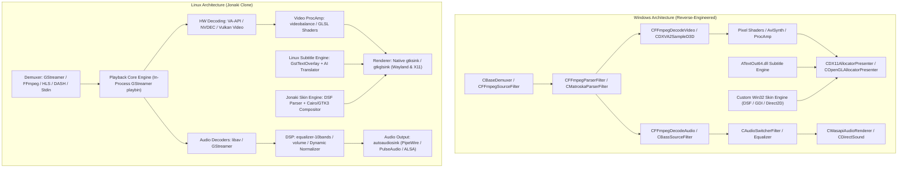

# Architecture Specification: Jonaki for Linux

This document outlines the architectural blueprint of **Jonaki for Linux**, derived from reverse-engineering the Windows Jonaki runtime binaries (`Jonaki64.dll`, `ffcodec64.dll`, `ATextOut64.dll`, `MediaDB64.dll`) and mapping them onto modern Linux platform facilities.

---

## 1. High-Level Architectural Comparison

Windows Jonaki utilizes the legacy Microsoft DirectShow filter graph architecture supplemented by custom allocator-presenters and hardware wrappers. For Linux, we establish an equivalent high-performance modular pipeline:



---

## 2. Reverse-Engineered Class Hierarchy (`Jonaki64.dll`)

Our binary extraction of `Jonaki64.dll` revealed the core object model of Jonaki. The table below documents each primary class, its Windows implementation, and the corresponding Linux class:

| Windows Class (RTTI) | Description | Linux Implementation Component |
| :--- | :--- | :--- |
| `CGraphBuilderManagerPlayer` | Master media controller orchestrating playback | `JonakiCore` (`src/core/engine.py` - GStreamer) |
| `CBaseDemuxer` / `CFFmpegSourceFilter` | Demuxes multimedia containers (MKV, MP4, AVI, TS) | Native GStreamer demuxing pipeline (`playbin`) |
| `CHlsDashParserFilter` / `CHlsDemuxer` | Adaptive bitrate network streaming (HLS, MPEG-DASH) | Native HLS/DASH network demuxing via `souphttpsrc` |
| `AVCFFmpegDecodeVideo` | Video decompression filter (AVC, HEVC, VP9, AV1) | HW-accelerated `vaapi`, `nvdec`, `vulkan` |
| `AVCFFmpegDecodeAudio` | Audio decompression filter (AAC, AC3, DTS, FLAC) | GStreamer audio decoders with passthrough |
| `CBassSourceFilter` / `CBassParserFilter` | Audio DSP and sound effects engine (Un4seen BASS) | Linux Audio DSP Engine (`equalizer-10bands`) |
| `COpenGLAllocatorPresenter` | Custom OpenGL rendering context and surface | Native `gtksink` / `gtkglsink` GTK widget |
| `AUIOpenGLPixelShader` | Pixel shader execution framework (HLSL -> GLSL) | `ShaderPipeline` using GLSL hooks / ProcAmp |
| `ATextOut64.dll` (`CTextRasterizer`) | Subtitle parser, layout engine, and glyph renderer | `SubtitleEngine` (`libass` + Cairo renderer) |
| `AVCCommonSkinLayout` | Skin parser, XML hierarchy, and coordinate mapper | `SkinEngine` (DSF ZIP extractor and layout) |
| `AVCCommonSkinSlider` | Custom timebar and volume slider with markers | `PotSkinSlider` (A-B repeat, bookmarks) |
| `CPlayListWnd` | Playlist window, history, and search | `PlaylistController` + SQLite3 storage |
| `MediaDB64.dll` | Persistence layer for playback resumes and history | `MediaDatabase` (`~/.config/jonaki/db.sqlite`)|
| `DaumCrashHandler64.dll` | Diagnostic logging and telemetry | Linux crash reporter and logging framework |

---

## 3. Core Subsystems Specification

### 3.1 Video Rendering & Hardware Acceleration

The Linux rendering architecture supports both **Wayland** (using `wl_surface` and EGL) and **X11** (using XComposite and GLX), with automatic fallback:

1. **Zero-Copy Hardware Acceleration**:
   - **Intel / AMD GPUs**: VA-API (`vaapi` / `vaapi-copy`) via `/dev/dri/renderD128`.
   - **NVIDIA GPUs**: NVDEC (`nvdec` / `nvdec-copy`) via VDPAU/CUDA.
   - **Modern Vulkan Video**: Direct hardware decoding via Vulkan Video extensions.
2. **Color Management & HDR Tone-Mapping**:
   - Integration with `libplacebo` for high-quality tone mapping (Reinhard, Mobius, Hable, BT.2390).
   - Support for SMPTE ST 2084 (PQ) and Hybrid Log-Gamma (HLG).
   - Display color profiles (ICC profile parsing).
3. **Deinterlacing & Post-Processing**:
   - Hardware deinterlacing (`bwdif`, `yadif`, `w3fdif`).
   - Frame rate doubling and cadenced telecine removal (IVTC).
   - 360° Equirectangular and VR stereoscopic video projection modes.

### 3.2 Audio Architecture

The audio subsystem provides ultra-low-latency playback, channel upmixing, and bit-perfect digital audio passthrough:

```
[Decoded PCM Float/Int]
       │
       ▼
[Channel Remapper: Mono/Stereo -> 5.1/7.1 or Downmix to Stereo]
       │
       ▼
[DSP Chain: 10-Band Equalizer -> Normalizer -> Compressor -> Pitch/Tempo Shift]
       │
       ▼
[Audio Resampler / Format Converter (soxr / FFmpeg swresample)]
       │
       ▼
┌───────────────────┬───────────────────┬───────────────────┐
│     PipeWire      │    PulseAudio     │  ALSA Exclusive   │
│  (Modern Linux)   │ (Standard Linux)  │ (Bit-Perfect SPDIF)│
└───────────────────┴───────────────────┴───────────────────┘
```

1. **Hardware Passthrough**: S/PDIF and HDMI passthrough for Dolby Digital (AC3), DTS, DTS-HD Master Audio, and TrueHD.
2. **DSP Filters**:
   - 10-Band Graphic Equalizer with pre-defined presets (Pop, Rock, Classical, Club, Vocal, Bass Boost, Treble Boost).
   - Dynamic Audio Normalization (evening out dialogue vs explosions).
   - Crystalizer / Harmonic Exciter.
   - Voice removal and Voice isolation (center channel filtering).

### 3.3 Skin & UI Compositor

Jonaki's signature visual identity relies on its `.dsf` skin format. The Linux clone implements a native DSF compositor:

1. **DSF Format Support**: Native decoding of `.dsf` archives (standard Deflate ZIP packages containing XML layout descriptors, `StringTable.txt`, and sprite atlases `Main.png`, `BRTool.png`, `Window.png`, `Control.png`).
2. **Nine-Slice Sprite Blitting**: Accurate 9-slice image scaling preserving borders and corner radii for buttons, titlebars, background panels, and scrollbars.
3. **Dynamic State Management**: Real-time rendering of button states (Normal, Hover/Over, Pressed/Down, Disabled).
4. **Hardware/Codec Badges**: The bottom video bar accurately renders the interactive status indicators:
   - `[HW]` / `[SW]` decoding toggle.
   - `[HDR]` tone-mapping toggle.
   - Codec fourcc badges (`H264`, `HEVC`, `AV1`, `VP9`, `AAC`, `FLAC`).
   - Channel layout badges (`2.0`, `5.1`, `7.1`).
   - Current time / Total time interactive labels.

### 3.4 Multi-Subtitle & Translation Engine

Jonaki features the most advanced subtitle engine of any consumer player. The Linux implementation replicates all capabilities:

1. **Simultaneous Multi-Track Display**: Support for displaying Primary, Secondary, and Tertiary subtitles simultaneously at customizable screen locations (Top, Bottom, Center).
2. **Real-Time Translation Pipeline**:
   - Real-time translation of active subtitle cues using external APIs (Google Translate, DeepL, Papago, Bing, LibreTranslate).
   - Offline local LLM translation support (connecting to LM Studio, Ollama, or vLLM via REST JSON).
3. **Speech-to-Text Subtitle Generation**:
   - On-the-fly subtitle generation from audio streams utilizing `whisper.cpp` with Vulkan GPU acceleration.
4. **Online Subtitle Scraping**:
   - Automated searching and downloading of subtitles from OpenSubtitles, SubDL, and Podnapisi based on video file hash and title.

### 3.5 Inter-Process Communication & Single-Instance Coordination

To replicate Windows Jonaki's `/new` and `/current` command-line behaviors:

- A Unix Domain Socket (`$XDG_RUNTIME_DIR/jonaki_ipc.sock`) operates as the IPC coordinator.
- When a new process is spawned:
  - If `/new` is specified, it creates a new independent player instance with an isolated IPC socket.
  - If `/current` or no flag is specified, it connects to the active instance socket, sends the command payload (e.g. `{"action": "open", "files": [...], "add_to_playlist": true}`), and terminates immediately.
- Standard input (`-`) is streamed to the player via a FIFO pipe or `/dev/stdin`.

### 3.6 Desktop Environment Integration

Jonaki for Linux integrates natively with Linux desktop environments (GNOME, KDE Plasma, XFCE, Cinnamon, Sway, Hyprland):

- **MPRIS2 D-Bus Interface**: Implements `org.mpris.MediaPlayer2` and `org.mpris.MediaPlayer2.Player` for system volume overlays, multimedia keys, notification controls, and lockscreen integration.
- **XDG Desktop Standard**: Provides `jonaki.desktop` with MIME type associations for over 150 audio, video, and playlist file formats.
- **System Tray**: Provides a system tray icon with playback controls and quick-access menu.
- **Inhibit Screensaver**: Prevents screen sleep during video playback via `org.freedesktop.ScreenSaver` and Wayland idle-inhibit protocol.
