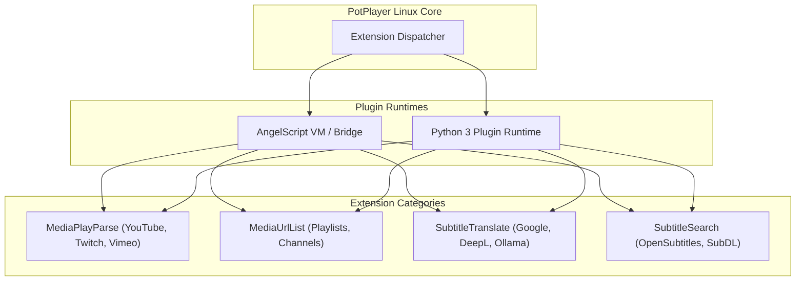

# Extension API Specification: AngelScript & Python Plugin Runtime

This document specifies the extensibility framework of PotPlayer for Linux, reverse-engineered from `extracted_potplayer/Extension/api.txt` and the native AngelScript plugins in `Extension/Media/` and `Extension/Subtitle/`.

---

## 1. Extension Runtime Architecture

PotPlayer supports hot-pluggable extensions for media parsing, online playlist retrieval, real-time subtitle translation, and automated subtitle downloading.

In the Linux implementation, the runtime provides **dual-runtime compatibility**:
1. **AngelScript Emulation Layer**: Allows existing `.as` scripts written for Windows PotPlayer to run unchanged via an AngelScript virtual machine or AST transpiler.
2. **Native Python Plugin Engine**: Allows developers to write modern Python plugins using standard libraries (`requests`, `json`, `bs4`, `yt-dlp`).



---

## 2. Reverse-Engineered `Host*` Built-in API Reference

The following APIs are exported by the player host environment to all running scripts:

### 2.1 Environmental & System APIs
```angelscript
int HostGetAPIVersion();
string HostGetVersion();
bool HostCheckVersion(int major, int minor, int build);
bool HostIsWin64();                       // Returns false or emulates 64-bit environment
void HostSleep(int ms);
uint HostGetTickCount();                  // Monotonic millisecond timer
void HostIncTimeOut(int ms);              // Extends script timeout for long HTTP queries
void HostOpenConsole();                   // Opens debug logging console
void HostPrintUTF8(const string &in log); // Prints diagnostic log
```

### 2.2 Filesystem & Path APIs
```angelscript
string HostGetScriptFolder();             // Directory of the executing script
string HostGetExtensionFolder();          // Root extensions directory
string HostGetTempFolder();               // System temporary directory (/tmp)
string HostGetConfigFolder();             // User configuration directory (~/.config/potplayer)
string HostGetExecuteFolder();            // PotPlayer installation directory
bool HostFileExist(const string &in fn);
bool HostFolderExist(const string &in fn);
bool HostFolderCreate(const string &in fn);
bool HostFolderDelete(const string &in fn);
```

### 2.3 Network & HTTP Client APIs
```angelscript
string HostUrlGetString(
    const string &in url, 
    const string &in userAgent = "", 
    const string &in referer = "", 
    const string &in headers = "", 
    bool redirect = true
);

string HostUrlPostData(
    const string &in url, 
    const string &in postData, 
    const string &in userAgent = "", 
    const string &in referer = "", 
    const string &in headers = "", 
    bool redirect = true
);

int HostUrlDownload(
    const string &in url, 
    const string &in targetPath, 
    const string &in userAgent = ""
);
```

### 2.4 JSON Parser Object Model (`JsonValue`, `JsonReader`)
```angelscript
class JsonValue {
    bool isNull();
    bool isBool();
    bool isInt();
    bool isUInt();
    bool isDouble();
    bool isString();
    bool isArray();
    bool isObject();
    
    int asInt();
    string asString();
    bool asBool();
    double asDouble();
    
    uint size();
    JsonValue opIndex(int index);           // Array indexing
    JsonValue opIndex(const string &in key); // Object dictionary lookup
};

class JsonReader {
    bool parse(const string &in document, JsonValue &out root);
};
```

---

## 3. Extension Interfaces

### 3.1 Subtitle Translation (`SubtitleTranslate`)
Located in `Extension/Subtitle/Translate/`:
```angelscript
// Script Metadata
string GetTitle();                                                     // Plugin display name
string GetVersion();                                                   // Plugin version string
string GetDesc();                                                      // Detailed description

// Language Capabilities
array<string> GetSrcLangs();                                          // List of supported source language codes
array<string> GetDstLangs();                                          // List of supported target language codes

// Translation Execution
string Translate(string Text, string &in SrcLang, string &in DstLang); // Executes translation of cue text
```

### 3.2 Subtitle Search & Download (`SubtitleSearch`)
Located in `Extension/Subtitle/Search/`:
```angelscript
string GetTitle();
string GetVersion();

// Query by file hash and title
array<SubtitleItem> SearchSubtitles(
    string FilePath, 
    string FileHash, 
    int64 FileSize, 
    string Title, 
    string Langs
);

// Download specific subtitle payload
bool DownloadSubtitle(string SubtitleUrl, string DestinationPath);
```

### 3.3 Media URL Parser (`MediaPlayParse`)
Resolves streaming platforms (e.g. YouTube, Vimeo) to direct playable stream URLs:
```angelscript
bool CheckUrl(const string &in url);                                  // Returns true if URL is handled
string PlayParse(const string &in url, string &out title);            // Returns direct stream URL (HLS/DASH/MP4)
```

---

## 4. Native Python Plugin Architecture

For Linux developers, plugins can also be implemented as lightweight Python modules:

```python
# ~/.config/potplayer/extensions/translate_ollama.py
import requests

class SubtitleTranslator:
    title = "Ollama Local LLM Translator"
    version = "1.0.0"
    
    def __init__(self, endpoint="http://localhost:11434/api/generate", model="qwen2.5:latest"):
        self.endpoint = endpoint
        self.model = model

    def translate(self, text: str, src_lang: str, dst_lang: str) -> str:
        prompt = f"Translate the following subtitle into {dst_lang}. Output only the translation: {text}"
        payload = {"model": self.model, "prompt": prompt, "stream": False}
        res = requests.post(self.endpoint, json=payload, timeout=2.0)
        return res.json().get("response", "").strip()
```
