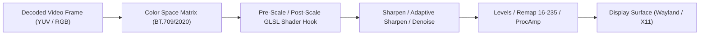

# Pixel Shaders & Motion Interpolation Specification

> [!NOTE]
> **Status: Reverse-Engineering Reference & Future Roadmap**  
> The core Linux playback engine currently supports active video shaders (Sharpen, Adaptive Sharpen, Denoise) through direct GLSL hook injection. The complete 34-shader library and VapourSynth/MVTools frame interpolation scripts documented below represent reverse-engineered Windows artifacts cataloged for future Linux implementation.

This document details the video post-processing pixel shader pipeline and VapourSynth/AviSynth motion interpolation engine, reverse-engineered from `extracted_jonaki/PxShader/`, `VapourSynth/`, and `AviSynth/`.

---

## 1. Pixel Shaders Pipeline (HLSL to GLSL Conversion)

Windows Jonaki utilizes DirectX 9 Pixel Shader 2.0/3.0 HLSL scripts located in `PxShader/`. In the Linux implementation, these shaders are mapped into **GLSL Hook Shaders** compatible with `libplacebo` and modern OpenGL/Vulkan pipelines.



### 1.1 Shader Catalog & Conversion Reference

The table below catalogs the 34 shaders extracted from Jonaki and their GLSL implementation details:

| Shader Name | File in `PxShader/` | Algorithmic Purpose | GLSL Mapping |
| :--- | :--- | :--- | :--- |
| **Sharpen (3x3)** | `Sharpen.txt`, `Sharpen_3x3.txt` | 3x3 Laplacian edge enhancement matrix | Convolution kernel with configurable edge width |
| **Adaptive Sharpen** | `Adaptive sharpen.txt` | Curve-driven sharpening preventing edge halos and ringing | Bilateral edge-weight filter |
| **Adaptive Sharpen (Contrast)** | `Adaptive sharpen(Contrast).txt` | High-frequency luminance emphasis | Local contrast thresholding |
| **Sharpen 5x5** | `Sharpen_5x5.txt` | Broad-radius unsharp mask | 25-tap discrete Gaussian difference |
| **Sharpen Complex 2** | `SharpenComplex2.txt` | Multi-pass directional sharpening | Gradient vector analysis |
| **Denoise** | `Denoise.txt` | Spatial median filter for grain and artifact removal | 9-tap 3x3 median sort filter |
| **Levels / Levels 2** | `Levels.txt`, `Levels2.txt` | Black point, white point, and gamma correction | Polynomial luminance remapping |
| **Remap 16-235** | `Remap_16_235.txt` | Expands TV range (16-235) to full PC range (0-255) | Linear range stretch |
| **Display < 16** | `DisplayLessThan16 v1_1.txt` | Highlighting crushed black areas for mastering | Colorized false-color luminance clipping |
| **BT.601 -> BT.709** | `BT601BT709.txt` | Matrix transform for SD content on HD screens | Color matrix multiplication |
| **LCD Angle Correction** | `LCD angle correction.txt` | Vertical gamma curve adjustment for TN/VA panels | Non-linear viewing angle compensation |
| **Night Vision** | `NightVision.txt` | Green phosphor amplification with noise simulation | Luminance green remapping + grain generator |
| **Contour / Emboss** | `Contour.txt`, `Emboss.txt` | Stylized edge and relief effects | Sobel directional gradient convolution |

---

## 2. HLSL to GLSL Conversion Example: `Sharpen.txt`

### 2.1 Original HLSL (`extracted_jonaki/PxShader/Sharpen.txt`)
```hlsl
sampler s0 : register(s0); 
float4 p0 : register(c0); 
#define width (p0[0]) 
#define height (p0[1]) 
#define effect_width (1.6) 
#define val0 (2.0) 
#define val1 (-0.125) 

float4 main(float2 tex : TEXCOORD0) : COLOR 
{ 
    float dx = effect_width / width; 
    float dy = effect_width / height; 
    float4 c1 = tex2D(s0, tex + float2(-dx,-dy)) * val1; 
    float4 c2 = tex2D(s0, tex + float2(0,-dy)) * val1; 
    float4 c3 = tex2D(s0, tex + float2(-dx,0)) * val1; 
    float4 c4 = tex2D(s0, tex + float2(dx,0)) * val1; 
    float4 c5 = tex2D(s0, tex + float2(0,dy)) * val1; 
    float4 c6 = tex2D(s0, tex + float2(dx,dy)) * val1; 
    float4 c7 = tex2D(s0, tex + float2(-dx,+dy)) * val1; 
    float4 c8 = tex2D(s0, tex + float2(+dx,-dy)) * val1; 
    float4 c9 = tex2D(s0, tex) * val0; 
    return (c1 + c2 + c3 + c4 + c5 + c6 + c7 + c8 + c9); 
}
```

### 2.2 Converted Linux GLSL Hook (`jonaki_sharpen.hook`)
```glsl
//!HOOK MAIN
//!BIND HOOKED
//!DESC Jonaki 3x3 Sharpen Shader

vec4 hook() {
    vec2 pt = HOOKED_pt;
    float effect_width = 1.6;
    float val0 = 2.0;
    float val1 = -0.125;
    vec2 d = effect_width * pt;

    vec4 c1 = HOOKED_tex(HOOKED_pos + vec2(-d.x, -d.y)) * val1;
    vec4 c2 = HOOKED_tex(HOOKED_pos + vec2(0.0,  -d.y)) * val1;
    vec4 c3 = HOOKED_tex(HOOKED_pos + vec2(-d.x,  0.0)) * val1;
    vec4 c4 = HOOKED_tex(HOOKED_pos + vec2( d.x,  0.0)) * val1;
    vec4 c5 = HOOKED_tex(HOOKED_pos + vec2(0.0,   d.y)) * val1;
    vec4 c6 = HOOKED_tex(HOOKED_pos + vec2( d.x,  d.y)) * val1;
    vec4 c7 = HOOKED_tex(HOOKED_pos + vec2(-d.x,  d.y)) * val1;
    vec4 c8 = HOOKED_tex(HOOKED_pos + vec2( d.x, -d.y)) * val1;
    vec4 c9 = HOOKED_tex(HOOKED_pos) * val0;

    return c1 + c2 + c3 + c4 + c5 + c6 + c7 + c8 + c9;
}
```

---

## 3. Motion Interpolation (VapourSynth & MVTools)

Jonaki features high-frame-rate motion interpolation (converting 24fps cinema content to 60fps or 144fps displays) using VapourSynth scripts located in `VapourSynth/motioninterpolation.vpy`.

### 3.1 Script Architecture (`motioninterpolation.vpy`)
```python
import vapoursynth as vs
core = vs.get_core()

# Limits & parameters
max_width = 1920
max_height = 1200
max_fps = 60
blocksize = 16

target_num = 60 if display_fps < 23.9 or display_fps > 300 else display_fps
target_den = int(1e6)
source_num = int(container_fps * 1e6)
source_den = int(1e6)

clip = video_in

if not (clip.width > max_width or clip.height > max_height or container_fps > max_fps):
    clip = core.std.AssumeFPS(clip, fpsnum=source_num, fpsden=source_den)
    sup = core.mv.Super(clip, pel=2, hpad=blocksize, vpad=blocksize)
    bv  = core.mv.Analyse(sup, blksize=blocksize, isb=True, chroma=True, search=3, searchparam=2)
    fv  = core.mv.Analyse(sup, blksize=blocksize, isb=False, chroma=True, search=3, searchparam=2)
    
    # Use BlockFPS for heavier workloads, FlowFPS for high-fidelity optical flow
    clip = core.mv.FlowFPS(clip, sup, bv, fv, num=target_num, den=target_den)

clip.set_output()
```

### 3.2 Linux Execution Pipeline
On Linux:
1. `vapoursynth` daemon / C API loads Python environment.
2. Frames from demuxer are fed to `video_in`.
3. MVTools plugin (`libmvtools.so`) computes bidirectional motion vectors (`bv`, `fv`) across consecutive frames.
4. Synthesized in-between frames are delivered to the video presentation queue with exact timing synchronization.
