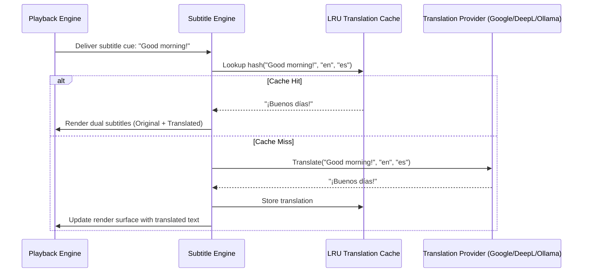

# Subtitle Engine & AI Translation Specification

This document details the subtitle rendering, multi-track composition, real-time AI translation, and speech-to-text subtitle generation pipelines of PotPlayer for Linux, reverse-engineered from `ATextOut64.dll`, `Module/Whisper/Vulkan/`, and the `Extension/Subtitle/` scripts.

---

## 1. Supported Subtitle Formats & Rasterization

| Format | Extension | Capabilities Supported | Implementation Engine |
| :--- | :--- | :--- | :--- |
| **Advanced SubStation Alpha** | `.ass`, `.ssa` | Vector drawings, positioning, karaoke timing, blur, outlines, rotations | `libass` |
| **SubRip** | `.srt` | Timed cues, basic HTML tags (`<b>`, `<i>`, `<u>`, `<font color>`) | Built-in SRT Parser -> `libass` |
| **Synchronized Accessible Media Interchange** | `.smi`, `.sami` | Multilingual class tracks, CSS styling, `<SYNC Start=...>` | SAMI Parser -> Multi-track dispatcher |
| **WebVTT** | `.vtt` | Cue settings, vertical layout, ruby text, CSS styling | WebVTT Parser -> `libass` |
| **VobSub (DVD)** | `.idx`, `.sub`| Bitmap subtitle streams with 4-color palette | FFmpeg bitmap decoder -> Cairo blitter |
| **Blu-ray Presentation Graphic Stream** | `.sup` | Full-color HD bitmap overlays | FFmpeg PGS decoder -> Cairo blitter |
| **Synchronized Lyrics** | `.lrc` | Audio playback line-by-line synchronized lyrics display | LRC Parser -> OSD subtitle overlay |

---

## 2. Simultaneous Multi-Track Display Pipeline

A signature capability of PotPlayer is displaying multiple subtitle streams simultaneously. For example, language learners frequently display English subtitles along with Japanese or Spanish subtitles concurrently:

```
┌────────────────────────────────────────────────────────┐
│ [Video Frame: 1920x1080]                               │
│                                                        │
│   (Top Subtitle Position - Secondary Track)            │
│   「こんにちは、世界へようこそ！」                      │
│                                                        │
│                                                        │
│                                                        │
│   (Bottom Subtitle Position - Primary Track)           │
│   "Hello, and welcome to the world!"                   │
│                                                        │
│   (Optional Translated Subtitle Line)                  │
│   [Translation: Bonjour et bienvenue dans le monde !]  │
└────────────────────────────────────────────────────────┘
```

### 2.1 Multi-Track Compositor Architecture
1. **Primary Subtitle Track**: Rendered at the bottom margin with customizable font size, outline, and shadow.
2. **Secondary Subtitle Track**: Rendered at the top margin (or custom vertical offset) with an independent font style, color, and size.
3. **Tertiary Subtitle Track**: Rendered in a floating centered box or user-specified coordinates.
4. **Independent Sync Offsets**: Each track maintains an independent timing offset (in milliseconds), allowing desynchronized external subtitles to be individually corrected.

---

## 3. Real-Time Subtitle Translation Engine

PotPlayer ships with an extensible AngelScript translation system located in `Extension/Subtitle/Translate/`. In PotPlayer for Linux, this is implemented as an asynchronous translation pipeline:



### 3.1 Supported Translation Backends

1. **Google Translate** (`SubtitleTranslate - google.as`):
   - Uses Google Translate REST API endpoints.
   - Automatic language detection (`auto` -> target language).
2. **DeepL API** (`SubtitleTranslate - DeepL.as`):
   - Supports DeepL Free and DeepL Pro API keys.
   - High-fidelity contextual translations.
3. **Papago NMT** (`SubtitleTranslate - papagoNMT.as`):
   - Optimized for Korean, Japanese, and Chinese linguistic pairs.
4. **Bing / Microsoft Translator** (`SubtitleTranslate - bing.as`).
5. **LibreTranslate** (`SubtitleTranslate - Libre.as`):
   - Self-hosted open-source translation server without API fees.
6. **Local LLM Translation (LM Studio / Ollama / vLLM)** (`SubtitleTranslate - LM Studio.as`):
   - Connects to local OpenAI-compatible endpoints (`http://localhost:1234/v1` or `http://localhost:11434/v1`).
   - Custom system prompt: `"You are a professional subtitle translator. Translate the given subtitle cue into the target language accurately and concisely. Return ONLY the translation."`

---

## 4. Real-Time Speech-to-Text Subtitle Generation (Whisper AI)

In `extracted_potplayer/Module/Whisper/Vulkan/`, PotPlayer includes a Vulkan-accelerated Whisper model. For Linux, we implement:

1. **Audio Extraction Pipeline**: Audio samples from the active stream are tapped via a circular ring buffer (16 kHz, 16-bit mono PCM).
2. **Voice Activity Detection (VAD)**: Silero-VAD or WebRTC VAD detects speech segments to avoid transcribing silent pauses or background music.
3. **Whisper Inference Core**:
   - Uses `whisper.cpp` with Vulkan or OpenVINO GPU acceleration.
   - Supports `tiny.en`, `base`, `small`, and `medium` multilingual models.
   - Generates timed subtitle cues on the fly with accurate PTS timestamps.
4. **OSD Presentation**: Live speech-to-text subtitles are overlaid seamlessly on the video.

---

## 5. Online Subtitle Search & Download Providers

Located in `Extension/Subtitle/Search/`, PotPlayer connects to major subtitle repositories:

1. **OpenSubtitles.org / OpenSubtitles.com**:
   - Calculates the **OpenSubtitles File Hash**:
     $$\text{Hash} = \text{FileSize} + \sum_{i=0}^{8191} \text{HeadUInt64}[i] + \sum_{j=0}^{8191} \text{TailUInt64}[j] \pmod{2^{64}}$$
   - Queries OpenSubtitles REST API with hash and language filters.
2. **SubDL**: Queries by movie/series title and IMDB/TMDB ID.
3. **Podnapisi**: Automated search with SHA1 media verification.
4. **Automatic Download & Auto-Mount**: Downloaded subtitles are automatically mounted and matched to the video track without requiring a player restart.

---

## 6. Subtitle Styling & Positioning Controls

PotPlayer provides comprehensive visual customization for subtitle text:

- **Typography**: Font family selector, font size (8pt to 72pt), bold, italic, underline.
- **Coloring**: Primary fill color, secondary karaoke fill color, outline color, drop-shadow color.
- **Borders & Shadows**: Configurable border width (0px to 10px), shadow depth, gaussian blur radius.
- **Screen Margins**: Left margin, right margin, top margin, bottom margin (in percentage of viewport or exact pixels).
- **Alignment**: Standard 9-point numpad alignment (Bottom-Center, Top-Center, Bottom-Left, etc.).
- **Collision Avoidance**: Automatic vertical stacking when multiple subtitle cues overlap in time.
